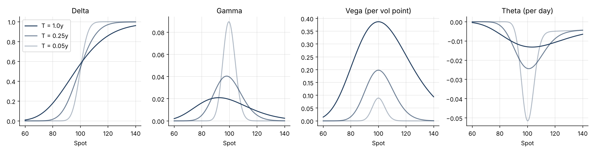
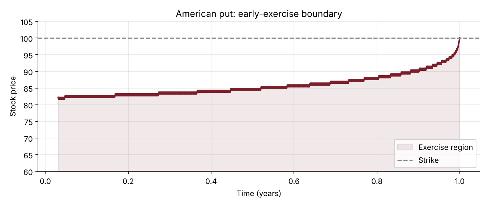

# 01 · Vanilla Option Pricing

**Black-Scholes pricer, analytical Greeks, implied-volatility solver and binomial tree for American options, each one checked against the others.**

`Python` `NumPy` `SciPy` · Derivatives pricing · Risk sensitivities



## Why it matters
Every derivatives desk, from equity structuring to market risk, relies on these building blocks: a fast pricer, exact sensitivities to hedge with, and a way to turn market prices into implied volatilities. The other pricing projects in this portfolio reuse these functions.

## What's inside
| File | Content |
|---|---|
| `options.py` | Black-Scholes-Merton prices, analytical Greeks, Newton-Raphson implied vol with a Brent fallback, Cox-Ross-Rubinstein tree with early-exercise boundary |
| `options_pricing.ipynb` | Theory, charts and checks, step by step |
| `test_options.py` | 17 unit tests: put-call parity, a textbook value, Greeks against finite differences, implied-vol round trips, tree convergence |

## Method
- **Black-Scholes-Merton** with a continuous dividend yield: $C = S e^{-qT}N(d_1) - K e^{-rT}N(d_2)$.
- **Greeks** in closed form, each one verified against a numerical bump in the tests.
- **Implied volatility**: Newton-Raphson on vega (quadratic convergence), with Brent's method as a safety net when vega vanishes.
- **CRR binomial tree**: backward induction with an early-exercise check at each node for American options.

## Key results
| Check | Result |
|---|---|
| Put-call parity gap | 0 (machine precision) |
| Implied vol round trip, 15 strike and vol cases | max error 9e-7 |
| Tree vs Black-Scholes, 800 steps | 0.0025 on a price of 8.83 |
| American put early-exercise premium (r = 6%) | 0.63, i.e. 12% of the European price |



## How to run
```bash
pip install -r ../requirements.txt
pytest -q                        # 17 tests
jupyter notebook options_pricing.ipynb
```

## Next steps
Discrete dividends, a trinomial tree, and pricing with the market smile (see project 03).
