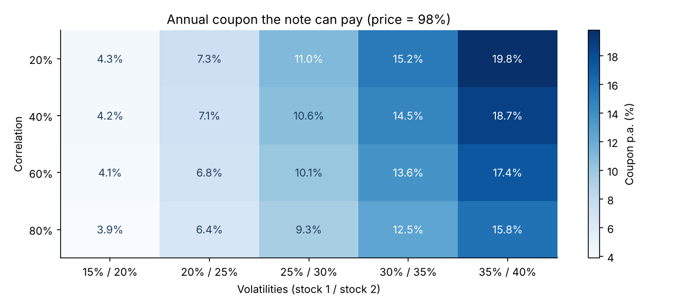
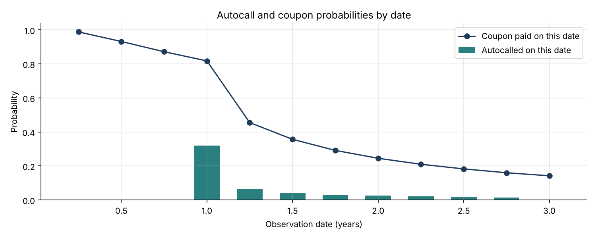

# 02 · Phoenix Autocall Pricer (Worst-of, Monte Carlo)

**Prices the structured product most sold to French retail and private-banking clients, explains its risks and solves for the coupon a bank can offer.**

`Python` `NumPy` · Monte Carlo · Structured products · Structuring



## The product
| Feature | Term |
|---|---|
| Underlyings | Worst-of two stocks |
| Maturity | 3 years, quarterly observations |
| Coupon | 2.5% per quarter if worst-of ≥ 70%, with memory |
| Autocall | From year 1, 100% repaid if worst-of ≥ 100% |
| Capital | Protected at maturity down to 60%, otherwise the worst-of performance |

## What's inside
| File | Content |
|---|---|
| `autocall.py` | Correlated GBM simulation (Cholesky, antithetic variates), cash-flow engine with memory coupons, Greeks by bump-and-reprice with common random numbers, fair-coupon solver |
| `autocall_pricer.ipynb` | Paths, price convergence, life statistics, sensitivities, structuring grid |
| `test_autocall.py` | 8 tests: exact zero-coupon and fixed-coupon limits, sign of the correlation and vol risks, memory value, fair-coupon repricing, probability consistency, antithetic variance reduction |

## Key results (vols 25% / 30%, correlation 60%, r = 3%)
| Output | Value |
|---|---|
| Price | **97.86%** of notional (standard error 0.04%) |
| Fair coupon at a 98% price | **10.1% p.a.** |
| Called at the first date (year 1) | 32% |
| Expected life | 2.1 years |
| Probability of capital loss | 23%, with an average loss of 54% when it happens |
| Vega (+1 vol point) | −1.05% |
| Correlation (+10 points) | +0.52% |

**Takeaway.** The investor is short volatility and long correlation: high volatility and low correlation make the coupon look attractive precisely because they make a capital loss more likely.



## How to run
```bash
pip install -r ../requirements.txt
pytest -q
jupyter notebook autocall_pricer.ipynb
```

## Next steps
Local or stochastic volatility (project 03), quanto adjustment for foreign underlyings, pathwise Greeks.
