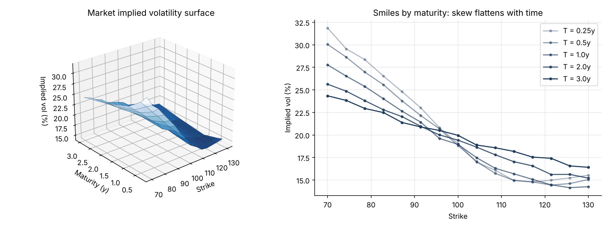
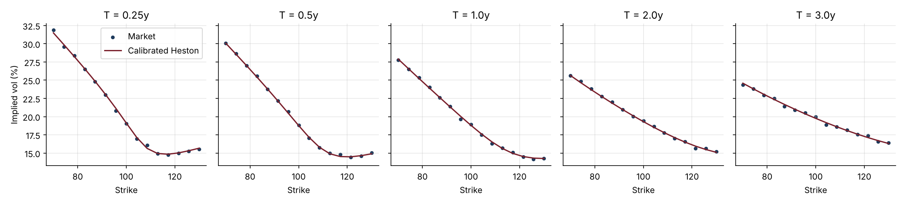

# 03 · Volatility Surface: Heston, SVI and Calibration

**Models the implied volatility surface with the two standard desk tools: the Heston stochastic-volatility model, priced by Fourier inversion, and SVI smiles with a butterfly-arbitrage check. Then calibrates Heston back to the whole surface.**

`Python` `NumPy` `SciPy` · Stochastic volatility · Fourier pricing · Calibration



## Why it matters
Black-Scholes uses one volatility, but the market quotes a different implied volatility for every strike and maturity. Pricing exotics, marking books and computing risk all require a smooth, arbitrage-free surface and a model calibrated to it.

## What's inside
| File | Content |
|---|---|
| `volsurface.py` | Heston characteristic function ("little trap" form), Gil-Pelaez call pricer, Monte Carlo validator, vega-weighted calibration; raw SVI with multi-start fitting and an arbitrage penalty; Durrleman's g(k) |
| `volatility_surface.ipynb` | Model theory, validation, the surface in 3D, SVI fits, Heston calibration |
| `test_volsurface.py` | 6 tests: Heston to Black-Scholes limit, Fourier vs Monte Carlo, skew sign, SVI parameter recovery, arbitrage detection, calibration recovery |

## Method
1. **Heston**: $dv_t = \kappa(\theta - v_t)dt + \sigma\sqrt{v_t}\,dW^v_t$, with spot-vol correlation $\rho$. Calls are priced in closed form through the characteristic function, and checked against Monte Carlo.
2. **Market surface**: 5 maturities × 15 strikes generated from a known Heston model, plus ±0.15 vol points of bid-ask noise.
3. **SVI**: $w(k) = a + b(\rho(k-m) + \sqrt{(k-m)^2+s^2})$ fitted smile by smile. A fit is accepted only if Durrleman's $g(k) \ge 0$, meaning the implied density stays positive.
4. **Calibration**: least squares on vega-weighted price errors, starting from a deliberately wrong guess.

## Key results
| Check | Result |
|---|---|
| Fourier vs Monte Carlo (300k paths) | within the Monte Carlo error bars |
| SVI fit error | 0.12 to 0.19 vol points, no butterfly arbitrage |
| Heston calibration | 4 s, RMSE 0.16 vol points |
| Recovered parameters | ρ −0.701 (true −0.70), v0 0.0401 (true 0.04), θ 0.050 (true 0.05) |



## How to run
```bash
pip install -r ../requirements.txt
pytest -q
jupyter notebook volatility_surface.ipynb
```

## Next steps
SSVI to remove calendar arbitrage across maturities, Dupire local volatility, and pricing project 02's autocall under Heston.
