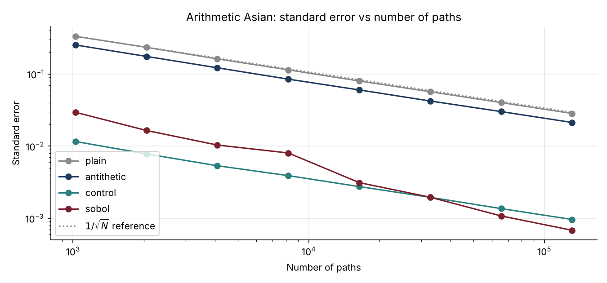
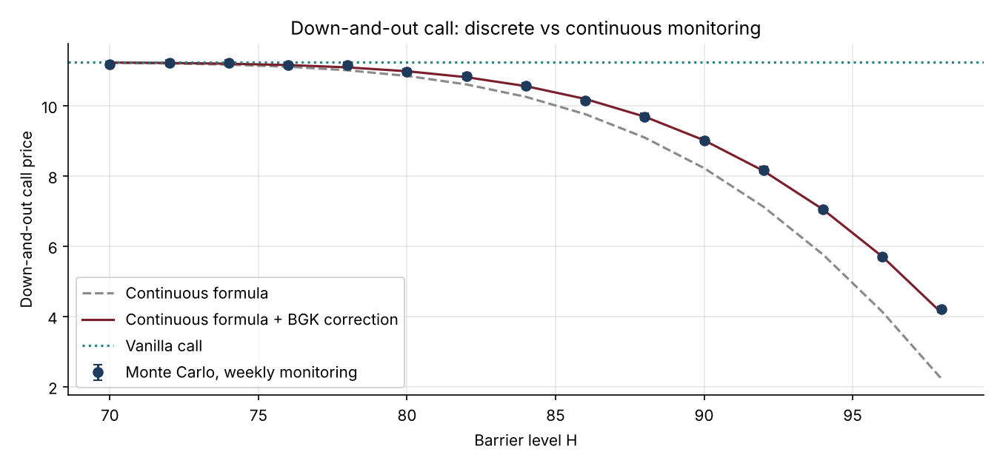

# 04 · Exotic Options by Monte Carlo, with Variance Reduction

**Prices Asian, barrier and lookback options by simulation, checks each one against a closed-form benchmark, and cuts the Monte Carlo error by 30 to 50 times with control variates and quasi-Monte Carlo.**

`Python` `NumPy` `SciPy` · Monte Carlo · Quasi-Monte Carlo · Path-dependent options



## Why it matters
A pricing library revalues thousands of path-dependent trades every night. The technique that removes 99.9% of the variance at the same cost decides whether a Monte Carlo price is usable on a desk.

## What's inside
| File | Content |
|---|---|
| `exotics.py` | GBM paths (plain, antithetic, Sobol + Brownian bridge), Asian/barrier/lookback pricers, closed forms (geometric Asian, Reiner-Rubinstein, Goldman-Sosin-Gatto), Broadie-Glasserman-Kou correction |
| `exotic_options.ipynb` | Theory, efficiency comparison, convergence rates, discrete vs continuous monitoring |
| `test_exotics.py` | 8 tests: Brownian bridge covariance, martingale property, geometric Asian formula, agreement of all methods, exact in-out parity, BGK accuracy, lookback correction |

## Key results (S = K = 100, T = 1y, σ = 25%)
| Arithmetic Asian, 131k paths | Price | Std error | Efficiency vs plain |
|---|---|---|---|
| Plain Monte Carlo | 6.787 | 0.0284 | 1× |
| Antithetic variates | 6.756 | 0.0214 | 3× |
| Control variate (geometric Asian) | 6.749 | 0.0010 | **~960×** |
| Sobol + Brownian bridge | 6.749 | 0.0005 | **~1,160×** |

- **Barrier (H = 90, weekly monitoring):** the continuous formula gives 8.22 against a true price of 9.02. The BGK-corrected formula gives 9.01.
- **Lookback:** the raw bias of −0.72 at daily monitoring drops to +0.01 with the continuity correction.



## How to run
```bash
pip install -r ../requirements.txt
pytest -q
jupyter notebook exotic_options.ipynb
```

## Next steps
Multilevel Monte Carlo, pathwise and likelihood-ratio Greeks, and the same payoffs under Heston (project 03).
