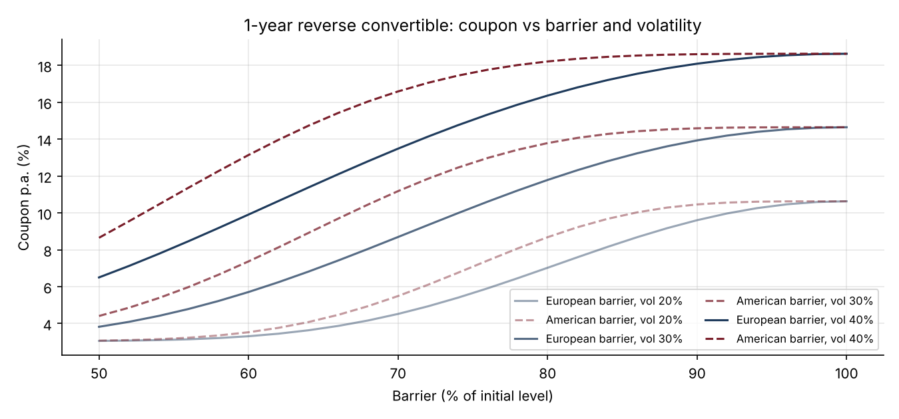
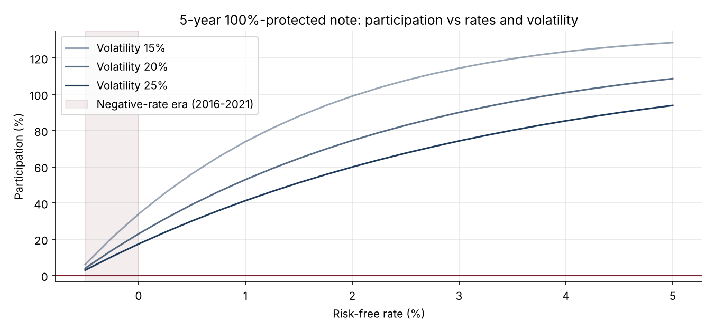

# 05 · Structuring Retail Notes: Capital Protection and Reverse Convertibles

[](https://colab.research.google.com/github/adamrejeb86-del/-finance-portfolio/blob/main/05-structured-notes/structured_notes.ipynb) [](https://nbviewer.org/github/adamrejeb86-del/-finance-portfolio/blob/main/05-structured-notes/structured_notes.ipynb)

**Breaks structured notes into a bond and options, prices each building block, and solves for the participation rate or coupon an issuer can offer after fees and funding.**

`Python` `NumPy` `SciPy` · Structuring · Barrier options · Issuer funding



## Why it matters
This is the day-to-day work of a structuring or equity-derivatives sales desk: a client asks for "capital protection on the CAC 40 over 5 years" or "a high coupon on a stock", and the desk must answer with terms that cover the hedging cost, the bank's funding and the fees.

## What's inside
| File | Content |
|---|---|
| `structuring.py` | Issuer zero-coupon with funding spread, vanilla, digital, European-barrier and down-and-in puts, solvers for the capital-protected note (with optional cap) and the reverse convertible |
| `structured_notes.ipynb` | The structurer's budget equation, payoff diagrams, sensitivity to rates, volatility and barriers, scenario table, term sheets |
| `test_structuring.py` | 9 tests: put-call parity, barrier and digital puts vs Monte Carlo, barrier limits, budget identities, monotonicity of terms |

## Key results (r = 3%, issuer spread 1%, vol 20%)
| Note | Headline term |
|---|---|
| 5y capital-protected note, 100% protection, 2% fees | **90% participation** |
| Same, upside capped at +40% | 151% participation |
| Same, 90% protection | 136% participation |
| 1y reverse convertible, no barrier | **10.6% coupon** |
| 1y reverse convertible, 70% European barrier | 4.5% coupon |
| 1y reverse convertible, 70% American barrier | 5.5% coupon |

**Takeaway.** Capital protection depends on the rate level (impossible to build with negative rates), while reverse convertibles monetise volatility: the coupon is the price of the put the client sells.



## How to run
```bash
pip install -r ../requirements.txt
pytest -q
jupyter notebook structured_notes.ipynb
```

## Next steps
Price with the volatility smile (project 03), add issuer call features, and combine with the autocall engine (project 02).
