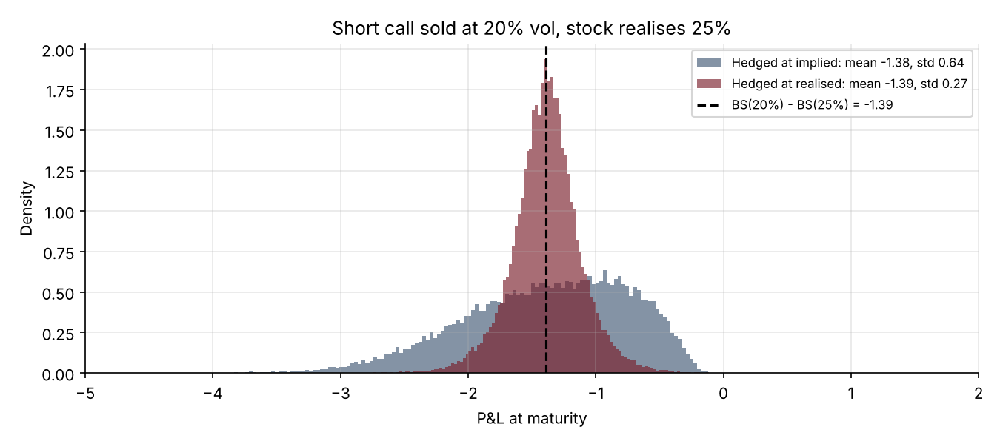
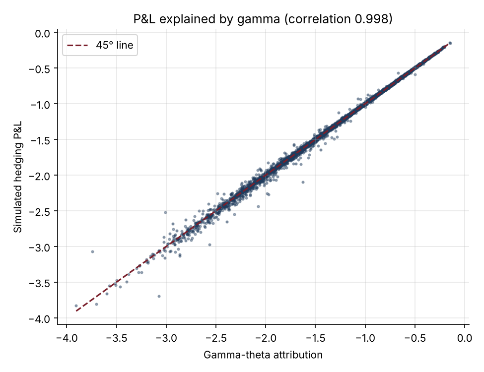

# 06 · Delta Hedging and P&L Attribution

[](https://colab.research.google.com/github/adamrejeb86-del/-finance-portfolio/blob/main/06-delta-hedging/delta_hedging.ipynb) [](https://nbviewer.org/github/adamrejeb86-del/-finance-portfolio/blob/main/06-delta-hedging/delta_hedging.ipynb)

**Simulates a trader who sells a call and delta hedges it. Measures the hedging error, shows what happens when realised volatility beats implied, explains the P&L with gamma and theta, and finds the best rebalancing frequency once transaction costs are counted.**

`Python` `NumPy` · Hedging · Greeks · Volatility trading



## Why it matters
Pricing tells you what an option is worth; hedging tells you what you actually earn. Explaining the daily P&L of an options book (gamma against theta, realised against implied volatility) is a core skill for trading, structuring and market risk roles.

## What's inside
| File | Content |
|---|---|
| `hedging.py` | Real-world GBM paths, a discrete delta-hedging engine with financing, dividends and transaction costs, gamma-theta P&L attribution |
| `delta_hedging.ipynb` | Hedging error vs frequency, volatility mismatch, P&L attribution, transaction-cost trade-off |
| `test_hedging.py` | 6 tests: zero mean P&L at fair vol, 1/√N scaling, locked-in P&L when hedging at realised vol, loss when vol is sold too cheap, attribution accuracy, effect of costs |

## Key results (6-month ATM call sold at 20% vol)
| Experiment | Result |
|---|---|
| Hedging error, weekly → daily → 4× daily | std 0.92 → 0.43 → 0.22, a fitted slope of about −0.5 |
| Stock realises 25%, hedged at implied | mean −1.38, wide path-dependent distribution |
| Stock realises 25%, hedged at realised | locked at BS(20%) − BS(25%) = −1.39, small dispersion |
| Gamma-theta attribution vs simulated P&L | correlation above 0.95 |
| Best frequency with 10 bp costs | about 250 rebalancings (twice a day) |



## How to run
```bash
pip install -r ../requirements.txt
pytest -q
jupyter notebook delta_hedging.ipynb
```

## Next steps
Leland's volatility adjustment, hedging bands (Whalley-Wilmott), vega hedging with a second option.
