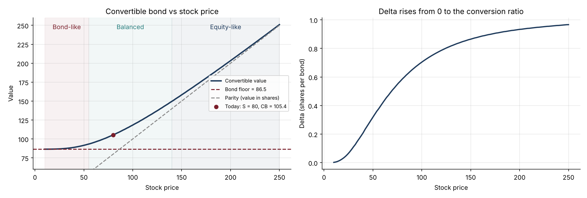

# 07 · Convertible Bond Pricer (Tsiveriotis-Fernandes)

**Prices a convertible bond on a binomial tree that splits its value into an equity part (discounted at the risk-free rate) and a credit-risky cash part (discounted at the risk-free rate plus the issuer's spread), with issuer calls and holder puts.**

`Python` `NumPy` · Convertible bonds · Credit risk · Binomial trees



## Why it matters
Convertibles sit between equity and credit. Asset managers run dedicated convertible funds, sold for their asymmetric profile, and banks run convertible arbitrage desks. Explaining the bond floor, parity, delta and the effect of credit spreads is the core of the job.

## What's inside
| File | Content |
|---|---|
| `convertible.py` | Tsiveriotis-Fernandes tree with coupons, voluntary conversion, issuer call with forced conversion, holder put; delta and gamma from the tree; bond floor, premiums, implied credit spread |
| `convertible_bond.ipynb` | The two discount rates, the classic convertible profile, scenario table, credit sensitivity, call and put features, implied spread |
| `test_convertible.py` | 8 tests: reduces to straight debt, stays above the bond floor and parity, trades at parity deep in the money, effect of call, put and spread, implied-spread round trip |

## Key results (stock 80, conversion price 100, 2% coupon, 5 years, spread 200 bp)
| Output | Value |
|---|---|
| Convertible value | **105.4** |
| Bond floor / parity | 86.5 / 80.0 |
| Conversion premium | 32% |
| Delta | 0.59 shares per bond |
| Issuer call from year 2 at 110 | −5.4 in value |
| Holder put at 100 in year 3 | +0.9 in value |
| Implied spread for a market price of 100 | 393 bp |

## How to run
```bash
pip install -r ../requirements.txt
pytest -q
jupyter notebook convertible_bond.ipynb
```

## Next steps
A credit spread linked to the stock price (distressed zone), soft calls (callable if the stock exceeds 130% for 20 of 30 days), dividend protection.
