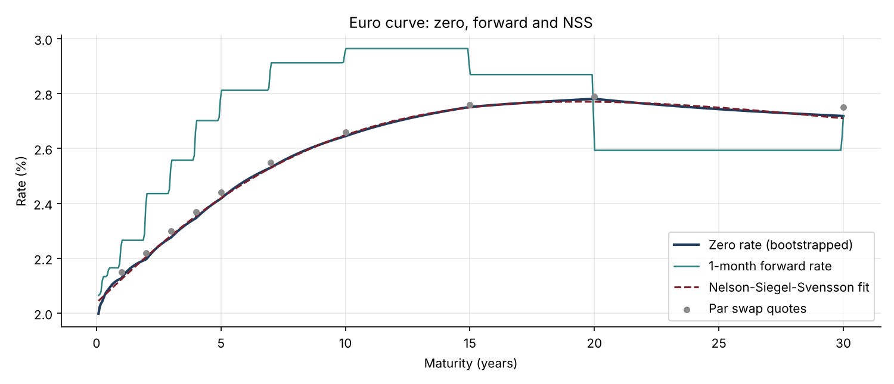
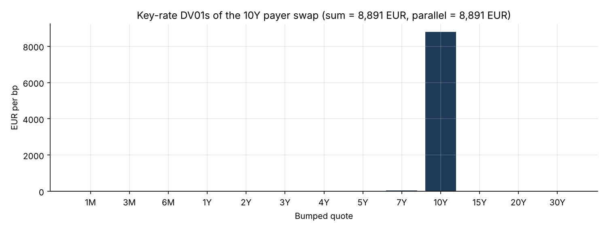

# 08 · Yield Curve Bootstrapping, Swaps and Bond Risk

**Builds a discount curve from deposits and par swap rates, fits Nelson-Siegel-Svensson, values a 10-year swap with its parallel and key-rate DV01s, and computes bond yield, duration and convexity.**

`Python` `NumPy` `SciPy` · Fixed income · Interest rate swaps · Rates risk



## Why it matters
Every fixed-income price, from a government bond to a structured note, depends on a discount curve. Rates traders, ALM teams and market risk managers spend their days on these numbers: par rates, DV01, bucketed risk, duration.

## What's inside
| File | Content |
|---|---|
| `curve.py` | Bootstrapping with log-linear discount factors, zero and forward rates, swap NPV and par rate, DV01 and key-rate DV01s by rebuilding the curve, NSS fit, bond price, yield, duration and convexity |
| `yield_curve_swaps.ipynb` | Method, curve charts, a 10Y swap and its risk ladder, the price-yield convexity chart |
| `test_curve.py` | 7 tests: exact repricing of every input, par swap worth zero, key rates add up to the parallel DV01, positive forwards, NSS accuracy, yield round trip, duration vs finite differences |

## Key results
| Output | Value |
|---|---|
| Repricing error on the 13 input instruments | < 1e-11 bp |
| 10Y par swap rate | 2.66% |
| €10m 10Y payer swap at 3.00% | NPV −€297k, DV01 +€8,900 per bp |
| Risk on the 10Y pillar | 99% of the total DV01 |
| 10Y 3% bond | price 102.97, yield 2.66%, modified duration 8.58, convexity 87.9 |



## How to run
```bash
pip install -r ../requirements.txt
pytest -q
jupyter notebook yield_curve_swaps.ipynb
```

## Next steps
Multi-curve framework (€STR discounting, Euribor forwarding), day-count conventions and calendars, monotone-convex interpolation.
