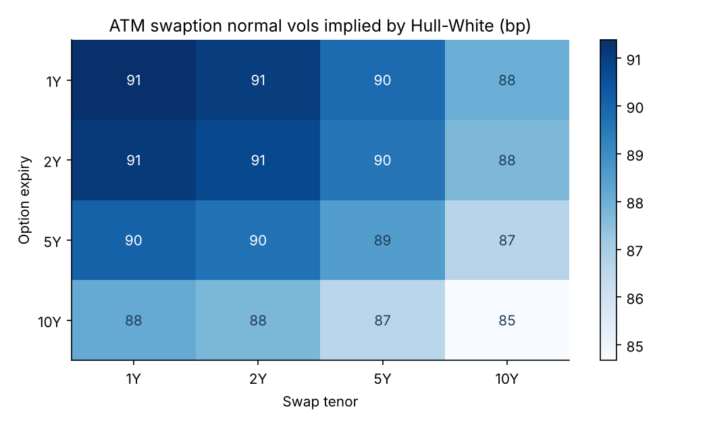
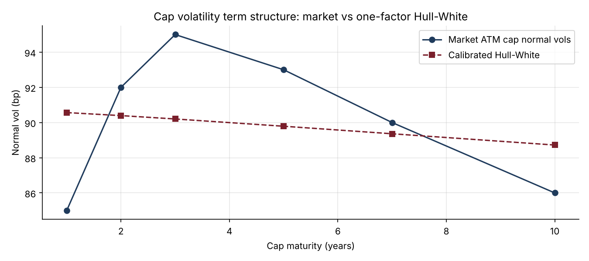

# 09 · Interest Rate Models: Hull-White, Caps and Swaptions

**Implements the one-factor Hull-White model: an exact fit to today's curve, closed-form caplets and Jamshidian swaptions validated by Monte Carlo, and calibration to market cap volatilities quoted in normal (Bachelier) terms.**

`Python` `NumPy` `SciPy` · Short-rate models · Rates options · Calibration



## Why it matters
Hull-White is the workhorse of rates desks, ALM teams and XVA engines. It prices caps, floors and swaptions consistently with the curve, and it is the standard engine for simulating future interest rates in counterparty-risk calculations.

## What's inside
| File | Content |
|---|---|
| `hullwhite.py` | Initial curve and instantaneous forwards, affine bond prices, options on zero-coupon bonds, caplets and caps, Jamshidian swaptions, exact short-rate simulation, Bachelier caps and swaptions, implied normal vols, calibration of (a, σ) |
| `interest_rate_models.ipynb` | Curve fit and simulation, cap calibration, swaption vol grid, effect of mean reversion |
| `test_hullwhite.py` | 7 tests: exact fit to the curve, Monte Carlo bond prices, put-call parity, caplet and swaption vs Monte Carlo, normal-vol round trip, calibration recovery |

## Key results
| Check | Result |
|---|---|
| Monte Carlo discount factors vs market, 1Y to 20Y | within 2 standard errors |
| Caplet and swaption closed forms vs Monte Carlo | within the Monte Carlo error |
| Calibration to ATM cap vols (85 to 95 bp) | a = 0.9%, σ = 90 bp, 3.9% RMSE on prices |
| Limitation found | constant-σ Hull-White cannot reproduce the 3Y hump in cap vols |



## How to run
```bash
pip install -r ../requirements.txt
pytest -q
jupyter notebook interest_rate_models.ipynb
```

## Next steps
Piecewise-constant σ(t), the two-factor G2++ model, Bermudan swaptions on a trinomial tree, exposure simulation for CVA (project 15).
