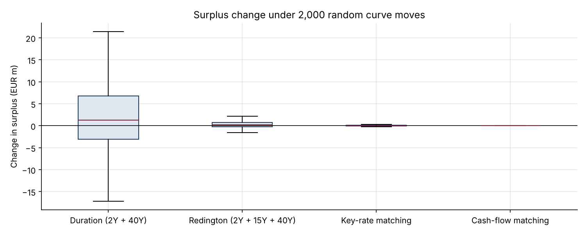
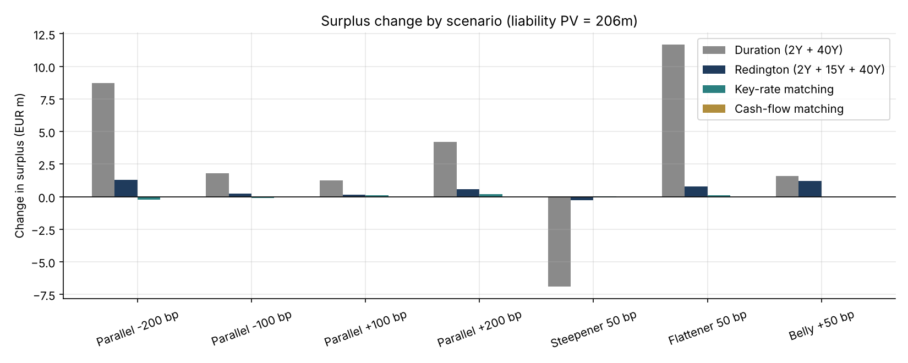

# 10 · Asset-Liability Management: Immunising a Pension Liability

[](https://colab.research.google.com/github/adamrejeb86-del/-finance-portfolio/blob/main/10-bond-portfolio-immunization/bond_portfolio_immunization.ipynb) [](https://nbviewer.org/github/adamrejeb86-del/-finance-portfolio/blob/main/10-bond-portfolio-immunization/bond_portfolio_immunization.ipynb)

**Hedges 40 years of pension payments with four bond strategies (duration matching, Redington immunisation, key-rate matching, cash-flow matching) and stresses each one with parallel, slope and curvature moves of the yield curve.**

`Python` `NumPy` `SciPy` · ALM · Duration & convexity · Linear programming



## Why it matters
Insurers and pension funds hold long liabilities whose value rises when rates fall. The hedge they choose decides whether their surplus, and their Solvency II capital, survives a move in the curve. The same logic applies to banks' ALM desks.

## What's inside
| File | Content |
|---|---|
| `alm.py` | Zero curve with parallel, twist, butterfly and key-rate shocks; liability and bond cash flows; Fisher-Weil duration and convexity; the four strategies (linear systems, NNLS, linear programming); 3-factor random curve moves |
| `bond_portfolio_immunization.ipynb` | Liability profile, portfolio construction, deterministic scenarios, surplus distribution |
| `test_alm.py` | 5 tests: PV and duration constraints, second-order surplus moves, Redington gains in both directions, coverage of every payment, key-rate matching beating duration matching on twists |

## Key results (liability PV €206m, duration 11.9 years)
| Strategy | Bonds | Steepener 50 bp | Surplus std, random curve moves |
|---|---|---|---|
| Duration matching (2Y + 40Y barbell) | 2 | −€6.9m | €9.3m (4.5% of PV) |
| Redington (2Y + 15Y + 40Y) | 3 | −€0.3m | €0.9m |
| Key-rate matching | 7 | ≈ 0 | €0.1m |
| Cash-flow matching | 40 | 0 | 0 |

**Takeaway.** Duration matching protects against parallel moves only. Most of the residual risk comes from the slope of the curve, and matching key-rate sensitivities removes it with a handful of bonds.



## How to run
```bash
pip install -r ../requirements.txt
pytest -q
jupyter notebook bond_portfolio_immunization.ipynb
```

## Next steps
Inflation-linked liabilities hedged with inflation swaps, swap overlays instead of physical bonds, Solvency II interest rate SCR.
