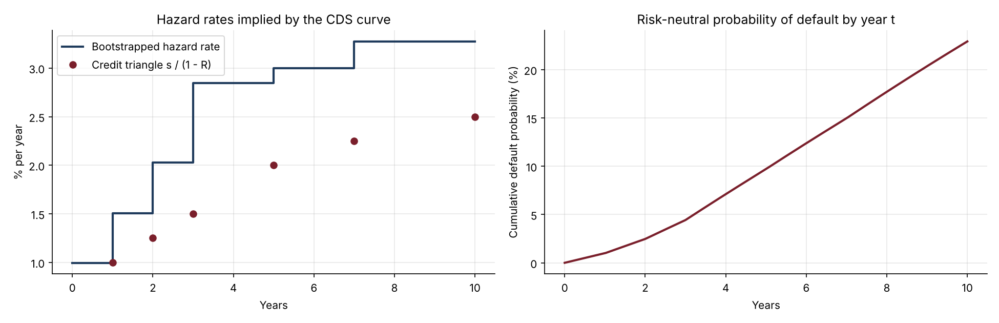
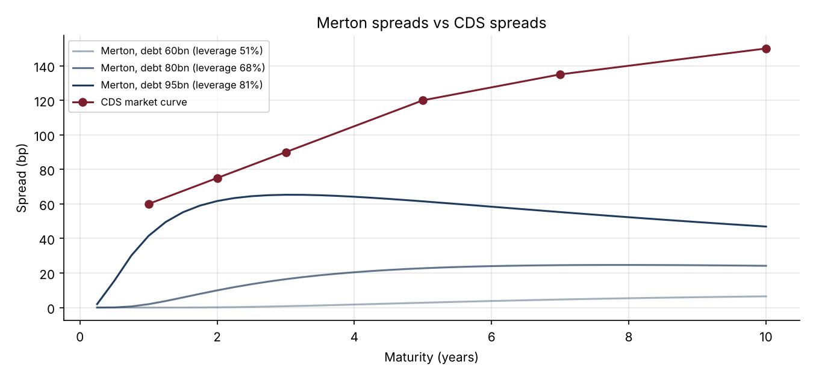

# 11 · Credit Risk: CDS Curves and the Merton Model

[](https://colab.research.google.com/github/adamrejeb86-del/-finance-portfolio/blob/main/11-credit-risk-cds-merton/credit_risk_cds_merton.ipynb) [](https://nbviewer.org/github/adamrejeb86-del/-finance-portfolio/blob/main/11-credit-risk-cds-merton/credit_risk_cds_merton.ipynb)

**Bootstraps default probabilities from a CDS curve, prices a standard-coupon CDS with its upfront, risky PV01 and CS01, then infers default risk from the share price with the Merton structural model, and compares both views.**

`Python` `NumPy` `SciPy` · Credit derivatives · Default probabilities · Structural models



## Why it matters
Credit analysts, CDS traders, counterparty-risk teams and convertible investors all need a default probability for each issuer. The market (CDS) and the balance sheet (Merton) give two views of the same risk, and comparing them is a classic interview topic.

## What's inside
| File | Content |
|---|---|
| `credit.py` | Piecewise-constant hazard curve, premium leg with accrual on default, protection leg, bootstrapping, standard-coupon upfront, CS01; Merton solver for asset value and volatility, distance to default, PD, spreads |
| `credit_risk_cds_merton.ipynb` | Hazard rates and default probabilities, CDS trading metrics and scenarios, equity-credit link, the credit spread puzzle |
| `test_credit.py` | 7 tests: exact repricing, credit triangle, monotone survival, zero upfront at par, sign of CS01, Merton consistency, spreads rising with leverage |

## Key results (BBB-type curve, 60 bp at 1Y to 150 bp at 10Y, recovery 40%)
| Output | Value |
|---|---|
| 5Y risk-neutral default probability | 9.7% |
| 5Y CDS on €10m, 100 bp coupon | upfront €89k, risky PV01 4.45, CS01 €4,400 per bp |
| Jump to default for the protection buyer | +€5.9m |
| Merton (equity €40bn, vol 45%, debt €80bn) | asset vol 15%, distance to default 2.6, 1Y spread 2 bp |

**Takeaway.** Merton links share price and credit risk well, but it misses short-dated spreads (2 bp against 60 bp in the market). This is the credit spread puzzle, and the reason practical models add jumps or an uncertain default barrier.



## How to run
```bash
pip install -r ../requirements.txt
pytest -q
jupyter notebook credit_risk_cds_merton.ipynb
```

## Next steps
CDS index tranches (project 12), wrong-way risk in CVA (project 15), mapping distance to default to real-world PDs (KMV).
