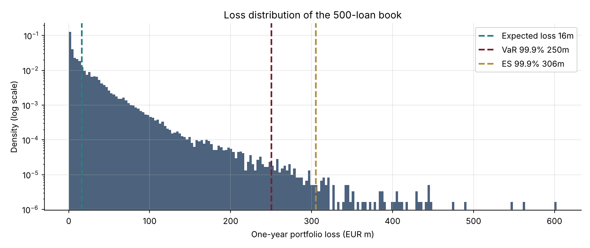
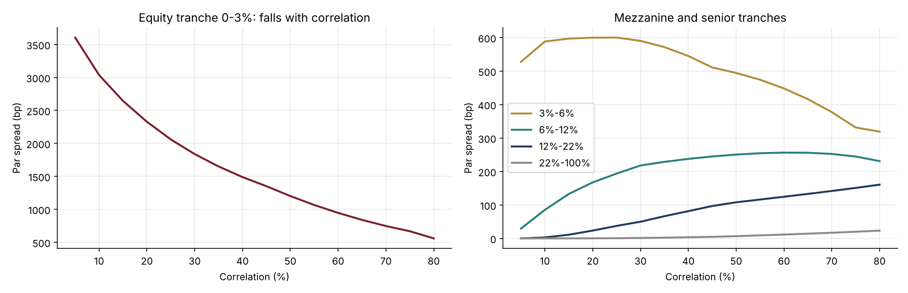

# 12 · Credit Portfolio Risk: Gaussian Copula, Basel Capital and CDO Tranches

[](https://colab.research.google.com/github/adamrejeb86-del/-finance-portfolio/blob/main/12-credit-portfolio-copula/credit_portfolio_copula.ipynb) [](https://nbviewer.org/github/adamrejeb86-del/-finance-portfolio/blob/main/12-credit-portfolio-copula/credit_portfolio_copula.ipynb)

**Simulates the loss distribution of a 500-loan corporate book with the one-factor Gaussian copula (Vasicek), computes credit VaR and economic capital, compares them with the Basel IRB formula, and prices CDO tranches as a function of correlation.**

`Python` `NumPy` `SciPy` · Credit portfolio models · Basel IRB · Structured credit



## Why it matters
Default correlation turns a loan book's risk from predictable into fat-tailed. The same model sets regulatory capital (Basel IRB), is used for economic capital by credit risk teams, and priced the CDO tranches at the heart of the 2007-2008 crisis.

## What's inside
| File | Content |
|---|---|
| `copula.py` | Monte Carlo of correlated defaults (Gaussian and Student-t copulas, obligor-specific correlations), VaR and ES, Vasicek large-pool distribution and quantile, Basel corporate correlation and IRB capital, semi-analytic tranche pricing by Gauss-Hermite integration |
| `credit_portfolio_copula.ipynb` | Portfolio, loss distribution, capital, effect of correlation, tail dependence and concentration, tranche spreads |
| `test_copula.py` | 8 tests: expected loss independent of correlation, Monte Carlo vs Vasicek closed form, quantile/CDF inversion, tail effects of correlation and of the t copula, tranches adding up to the pool, correlation sign of equity and senior tranches, IRB monotonicity |

## Key results (500 loans, €5bn, LGD 45%)
| Output | Value |
|---|---|
| Expected loss | €16m |
| VaR 99.9% / ES 99.9% | €250m / €306m |
| Economic capital (VaR − EL) | about €234m, 4.7% of exposure |
| Basel IRB capital | €175m |
| Same book with equal exposures | VaR 99.9% €198m: the gap is concentration risk |

**Tranches (5Y, index spread about 72 bp):** at 10% correlation the equity tranche pays about 3,000 bp; at 70% it pays 750 bp. The senior 22-100% tranche moves from 0 to 17 bp. Equity is long correlation, senior is short.



## How to run
```bash
pip install -r ../requirements.txt
pytest -q
jupyter notebook credit_portfolio_copula.ipynb
```

## Next steps
Multi-factor model with sectors, stochastic recovery, base-correlation calibration to market tranche quotes.
