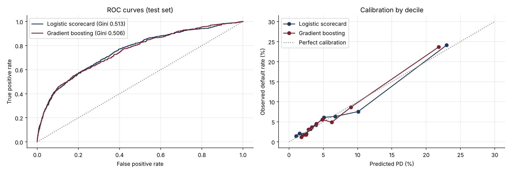
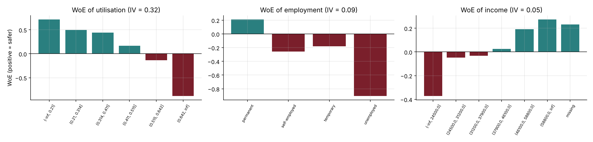

# 13 · Credit Scoring: Regulatory Scorecard vs Machine Learning

[](https://colab.research.google.com/github/adamrejeb86-del/-finance-portfolio/blob/main/13-credit-scoring-ml/credit_scoring.ipynb) [](https://nbviewer.org/github/adamrejeb86-del/-finance-portfolio/blob/main/13-credit-scoring-ml/credit_scoring.ipynb)

**Builds a probability-of-default model for 30,000 loan applications, twice: a Weight-of-Evidence logistic scorecard with a points table, and a gradient-boosting model. Then validates both the way a bank's model risk team would.**

`Python` `pandas` `scikit-learn` · PD models · Model validation · Explainability



## Why it matters
Every retail and SME loan decision runs through a scoring model, and Basel IRB banks must prove that their PDs are discriminating, calibrated and stable. The trade-off between ML accuracy and scorecard transparency is a live debate in credit risk and model validation teams.

## What's inside
| File | Content |
|---|---|
| `scoring.py` | Synthetic application generator (non-linear effects, interaction, missing values), WoE encoder with Information Value, points scorecard, Gini, KS, calibration, PSI, rating master scale |
| `credit_scoring.ipynb` | Risk drivers, WoE/IV analysis, scorecard, gradient boosting, ROC and calibration, permutation importance, master scale, stability monitoring |
| `test_scoring.py` | 7 tests: WoE ordering and IV, missing-value bin, metric definitions, points table reproducing the logistic model exactly, calibration, PSI detection, master-scale coverage |

## Key results (test set, 9,000 applications, 5.9% default rate)
| Model | Gini | KS | Mean PD vs observed |
|---|---|---|---|
| WoE logistic scorecard | **0.51** | 0.37 | 5.91% vs 5.89% |
| Gradient boosting | 0.51 | 0.37 | 5.86% vs 5.89% |

- **Strongest drivers (IV):** late payments 0.50, utilisation 0.32, debt-to-income 0.27.
- **Stability:** a downturn population (more debt, higher utilisation) gives a PSI of 0.31, above the 0.25 review threshold.

**Takeaway.** With careful binning, the transparent scorecard is as accurate as gradient boosting on this data. ML is then best used as a challenger model.



## How to run
```bash
pip install -r ../requirements.txt
pytest -q
jupyter notebook credit_scoring.ipynb
```

## Next steps
Reject inference, SHAP explanations, IFRS 9 lifetime PD term structures, fairness checks across customer groups.
