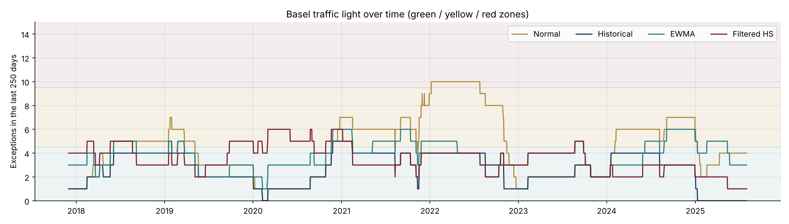
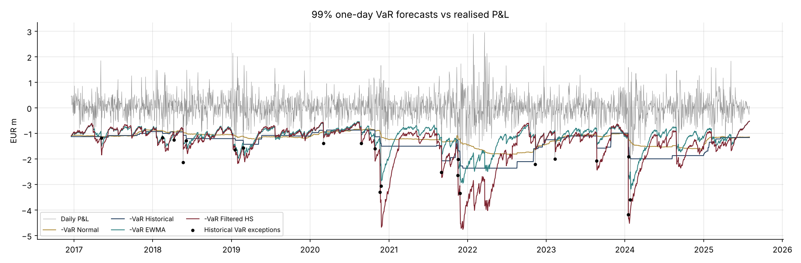

# 14 · Market Risk: VaR Model Backtesting and Stress Testing

[](https://colab.research.google.com/github/adamrejeb86-del/-finance-portfolio/blob/main/14-market-risk-var-backtesting/market_risk_var_backtesting.ipynb) [](https://nbviewer.org/github/adamrejeb86-del/-finance-portfolio/blob/main/14-market-risk-var-backtesting/market_risk_var_backtesting.ipynb)

**Runs four VaR models (parametric, historical, EWMA, filtered historical simulation) on a €100m multi-asset portfolio over ten years, and puts them through the tests a regulator applies: Kupiec, Christoffersen, the Basel traffic light, the Acerbi-Szekely ES test, then historical and reverse stress tests.**

`Python` `NumPy` `pandas` `SciPy` · Market risk · Model validation · Basel / FRTB



## Why it matters
Computing a VaR is easy; proving it is right is the job of market risk and model validation teams. The number of backtesting exceptions sets the bank's capital multiplier, and FRTB moved capital from VaR to Expected Shortfall.

## What's inside
| File | Content |
|---|---|
| `varbt.py` | Synthetic market with fat tails, volatility clustering and a stress regime; rolling VaR and ES for four models; Kupiec, Christoffersen, traffic light, Acerbi-Szekely Z2 with its simulated critical value; stress and reverse stress tests |
| `market_risk_var_backtesting.ipynb` | P&L and tails, VaR forecasts, backtest tables, traffic light over time, ES test, stress scenarios |
| `test_varbt.py` | 7 tests: Kupiec and Christoffersen behaviour, traffic-light zones, normal VaR passing on normal data, historical VaR as the empirical quantile, Z2 centred under a correct model, stress-test linearity |

## Key results (2,250 backtest days, 22.5 exceptions expected at 99%)
| Model | Exceptions | Kupiec p | Worst 250-day zone | ES test (Z2) |
|---|---|---|---|---|
| Parametric normal | 38 | 0.003 | red | rejected |
| EWMA (λ = 0.94) | 33 | 0.04 | yellow | rejected |
| Historical simulation | 22 | 0.92 | yellow | passes |
| Filtered historical | 30 | 0.13 | yellow | passes |

**Stress tests:** the 2008, 2020, 2011 and 2022 scenarios cost €12m to €15m, or 11 to 13 times the daily VaR. In the 2022 scenario, bonds stop hedging equities.



## How to run
```bash
pip install -r ../requirements.txt
pytest -q
jupyter notebook market_risk_var_backtesting.ipynb
```

## Next steps
Stressed VaR (Basel 2.5), FRTB liquidity horizons, the P&L attribution test.
