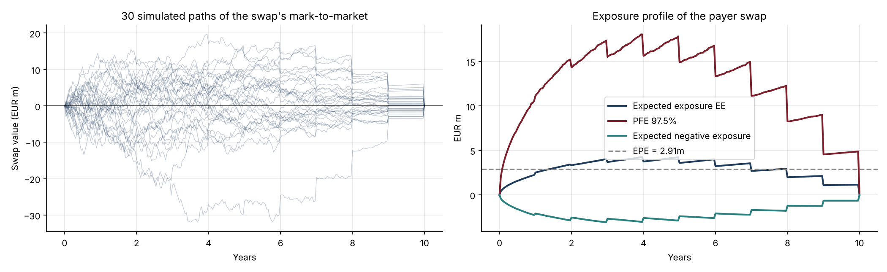
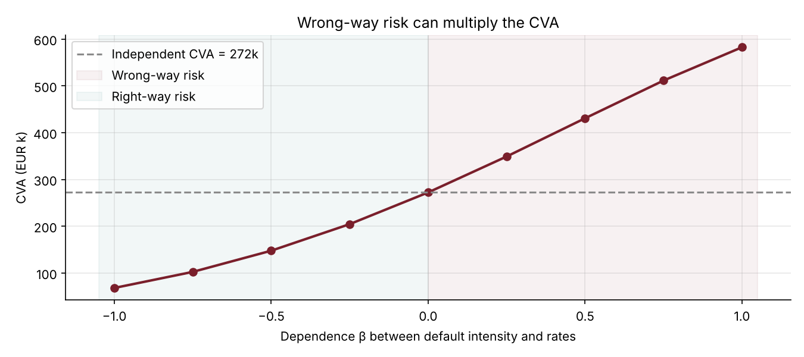

# 15 · Counterparty Risk: Exposure Simulation and CVA of an Interest Rate Swap

[](https://colab.research.google.com/github/adamrejeb86-del/-finance-portfolio/blob/main/15-counterparty-risk-cva/counterparty_risk_cva.ipynb) [](https://nbviewer.org/github/adamrejeb86-del/-finance-portfolio/blob/main/15-counterparty-risk-cva/counterparty_risk_cva.ipynb)

**Simulates future interest rates with Hull-White, revalues a €100m 10-year swap on 20,000 paths, builds EE and PFE profiles, measures the effect of netting and collateral, and computes CVA, DVA, the CVA charge to the client and the impact of wrong-way risk.**

`Python` `NumPy` · Counterparty credit risk · XVA · Exposure simulation



## Why it matters
Since 2008, every derivative price includes valuation adjustments for counterparty risk. XVA desks, counterparty-risk teams and regulators (Basel CVA capital, SA-CCR) all rely on the same chain: simulate the market, revalue the trades, aggregate the exposure, and price the default risk.

## What's inside
| File | Content |
|---|---|
| `cva.py` | Hull-White factor simulation and closed-form bond prices, exact swap valuation with floating fixings, EE/ENE/PFE/EPE, CSA collateral with threshold, minimum transfer amount and margin period of risk, CVA/DVA with optional wrong-way risk, CVA as a running spread |
| `counterparty_risk_cva.ipynb` | Exposure profiles, netting and collateral, CVA by client spread, wrong-way risk |
| `test_cva.py` | 6 tests: curve repricing, zero value at start and end, martingale property of discounted values, netting and collateral benefits, CVA monotonic in spread and in wrong-way dependence |

## Key results (10Y payer swap at par, €100m)
| Output | Value |
|---|---|
| Peak PFE 97.5% | €18.1m after 4 years |
| EPE | €2.9m |
| CVA, client spread 120 bp equivalent (λ = 2%) | €272k |
| With netting / with CSA (threshold €2m) / zero threshold | €234k / €89k / €12k |
| CVA charge, client at 50 / 100 / 200 / 400 bp | 1.4 / 2.9 / 5.8 / 11.9 bp per year |
| Wrong-way risk (β = +1) | 2.1× the independent CVA |



## How to run
```bash
pip install -r ../requirements.txt
pytest -q
jupyter notebook counterparty_risk_cva.ipynb
```

## Next steps
FVA and MVA, CVA sensitivities and CDS hedging, SA-CCR, American Monte Carlo for callable trades.
