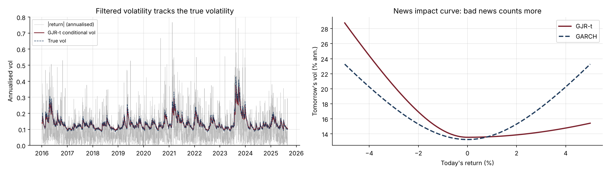
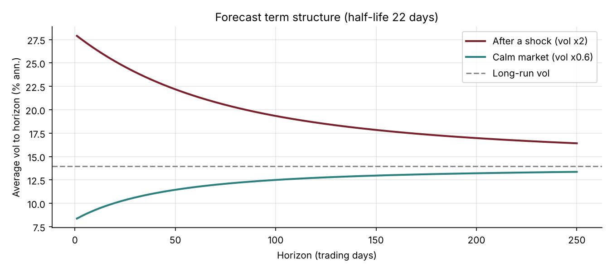

# 16 · Volatility Forecasting with GARCH

[](https://colab.research.google.com/github/adamrejeb86-del/-finance-portfolio/blob/main/16-garch-volatility-forecasting/garch_volatility.ipynb) [](https://nbviewer.org/github/adamrejeb86-del/-finance-portfolio/blob/main/16-garch-volatility-forecasting/garch_volatility.ipynb)

**Estimates GARCH(1,1) and GJR-GARCH with Student-t innovations by maximum likelihood, then runs an out-of-sample forecasting contest against rolling historical volatility and EWMA. Applications cover the volatility term structure and VaR.**

`Python` `NumPy` `SciPy` · Time series · Maximum likelihood · Volatility modelling



## Why it matters
Volatility is the input of option pricing, VaR, risk budgeting and volatility-targeting funds. Unlike returns it is predictable, and forecasting it well is a core skill for quant research, risk and derivatives roles.

## What's inside
| File | Content |
|---|---|
| `garch.py` | Variance recursion, Gaussian and standardised Student-t likelihoods, constrained MLE (rescaled for stability), multi-step forecasts, news impact curve, simulator, EWMA, QLIKE loss |
| `garch_volatility.ipynb` | Volatility clustering, estimation table, leverage effect, forecasting contest, term structure, VaR |
| `test_garch.py` | 6 tests: parameter recovery, likelihood and AIC ranking, mean reversion of forecasts, asymmetry, recursion, QLIKE minimised by the truth |

## Key results (10 years simulated from a known GJR-GARCH-t process)
| Model (out of sample, 3 years) | Error vs true vol | QLIKE |
|---|---|---|
| GJR-GARCH Student-t | **1.0 vol pt** | **1.443** |
| GARCH(1,1) normal | 2.1 | 1.480 |
| EWMA (λ = 0.94) | 2.1 | 1.529 |
| Historical 20 days / 60 days | 2.7 / 3.9 | 1.616 / 1.568 |

- **Leverage effect:** γ ≈ 0.09 against α ≈ 0.01, so falls drive volatility.
- **99% VaR backtest:** 8 exceptions with the GJR-t quantile (7.6 expected), against 14 with EWMA-normal.



## How to run
```bash
pip install -r ../requirements.txt
pytest -q
jupyter notebook garch_volatility.ipynb
```

## Next steps
Realised volatility and HAR models, DCC-GARCH for correlations, GARCH option pricing (Heston-Nandi).
