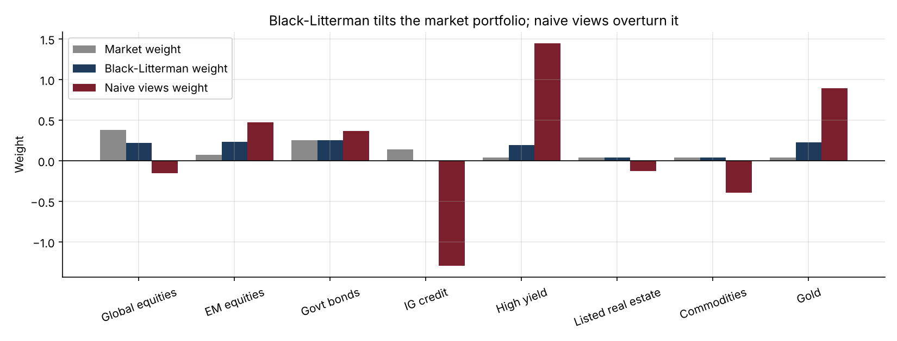
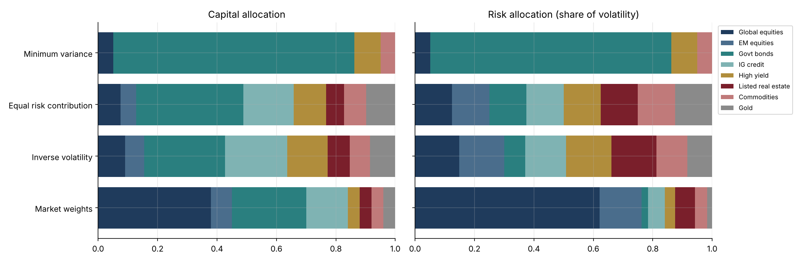

# 17 · Multi-Asset Allocation: Markowitz, Risk Parity and Black-Litterman

[](https://colab.research.google.com/github/adamrejeb86-del/-finance-portfolio/blob/main/17-risk-parity-black-litterman/risk_parity_black_litterman.ipynb) [](https://nbviewer.org/github/adamrejeb86-del/-finance-portfolio/blob/main/17-risk-parity-black-litterman/risk_parity_black_litterman.ipynb)

**Allocates a fund across eight asset classes three ways. Shows why mean-variance optimisation with estimated returns is unstable, how risk parity balances risk instead of capital, and how Black-Litterman blends the manager's views with market equilibrium.**

`Python` `NumPy` `SciPy` · Portfolio construction · Asset allocation · Optimisation



## Why it matters
Multi-asset, wealth-management and pension teams decide allocations every quarter. Knowing why naive Markowitz fails and how practitioners fix it (risk budgeting, Black-Litterman) is a standard asset-management interview topic.

## What's inside
| File | Content |
|---|---|
| `allocation.py` | Covariance from vols and correlations, portfolio statistics, Euler risk contributions, long-only min-variance, max-Sharpe and frontier, risk budgeting by Spinu's convex formulation, reverse optimisation, Black-Litterman posterior with view confidences |
| `risk_parity_black_litterman.ipynb` | Markowitz instability by resampling, capital vs risk allocation, views and posterior weights, efficient frontier |
| `test_allocation.py` | 9 tests: risk contributions add up, equal and custom risk budgets, min-variance optimality, reverse optimisation recovers market weights, BL without new information stays at equilibrium, BL moves towards a view with confidence, views move only the assets they involve, max-Sharpe optimality |

## Key results
| Finding | Value |
|---|---|
| Max-Sharpe portfolios from 200 plausible 10-year histories | 2.8 of 8 assets held on average, 77% turnover from one history to the next |
| Market portfolio: capital vs risk | 45% in equities, but most of the risk |
| Risk parity | vol 6.2% (vs 8.6% for market weights), similar Sharpe ratio (0.19 vs 0.21) |
| Black-Litterman with three views | EM equities 7% → 23%, gold 4% → 22%, bonds unchanged at 25% |
| Same views plugged straight into Markowitz | −130% IG credit, +145% high yield |



## How to run
```bash
pip install -r ../requirements.txt
pytest -q
jupyter notebook risk_parity_black_litterman.ipynb
```

## Next steps
Ledoit-Wolf shrinkage, hierarchical risk parity, transaction-cost-aware rebalancing, backtests (project 19).
