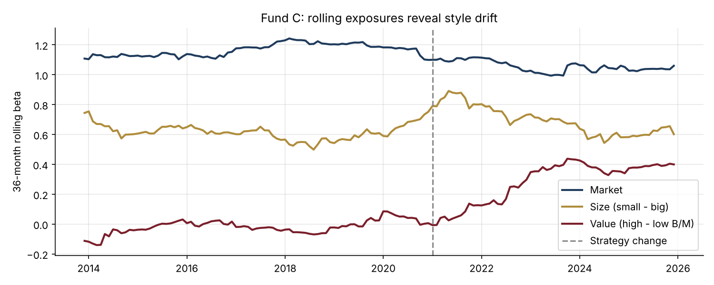
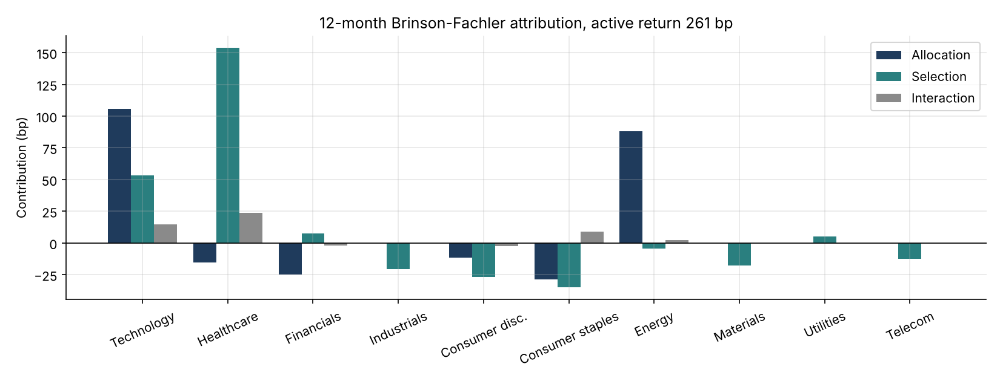

# 18 · Factor Models and Performance Attribution

[](https://colab.research.google.com/github/adamrejeb86-del/-finance-portfolio/blob/main/18-factor-models-attribution/factor_models_attribution.ipynb) [](https://nbviewer.org/github/adamrejeb86-del/-finance-portfolio/blob/main/18-factor-models-attribution/factor_models_attribution.ipynb)

**Separates skill from factor exposure for three funds with factor regressions and Newey-West errors, detects style drift with rolling betas, and explains an equity fund's active return by sector with Brinson-Fachler attribution linked over 12 months (Carino).**

`Python` `NumPy` `pandas` · Fund analysis · Factor investing · Performance attribution



## Why it matters
Fund selectors, consultants, wealth managers and asset-management sales teams must explain where performance comes from. Clients pay active fees for alpha, not for a value or quality tilt they could buy in an ETF.

## What's inside
| File | Content |
|---|---|
| `factors.py` | Simulated factor returns (market, size, value, momentum, quality) and funds with known exposures, OLS with Newey-West errors, rolling betas, return decomposition, Brinson-Fachler effects, Carino linking, performance statistics |
| `factor_models_attribution.ipynb` | Three fund case studies, return decomposition, style drift, sector attribution, risk-adjusted statistics |
| `test_factors.py` | 6 tests: recovery of true betas and alpha, HAC vs OLS errors, drift detection, Brinson effects adding up, Carino linking matching the compounded active return, statistics on a known series |

## Key results (15 years of monthly data)
| Fund | Alpha (p.a.) | t-stat | Verdict |
|---|---|---|---|
| A, European Value | 0.7% | 1.1 | outperformance consistent with a value tilt and no skill |
| B, Quality Growth | **2.0%** | **2.2** | genuine skill on top of quality and momentum tilts |
| C, Small Cap Opp. | 0.6% (true −1%) | 0.5 | alpha impossible to pin down; style drift into value after year 10 |

**Brinson-Fachler (12 months):** active return of 261 bp, split into 113 bp allocation (technology overweight), 103 bp selection (healthcare stock picking) and 45 bp interaction. The linked effects add up exactly.



## How to run
```bash
pip install -r ../requirements.txt
pytest -q
jupyter notebook factor_models_attribution.ipynb
```

## Next steps
Barra-style holdings-based risk model, fixed-income attribution (carry, curve, spread), factor-based fund screening.
