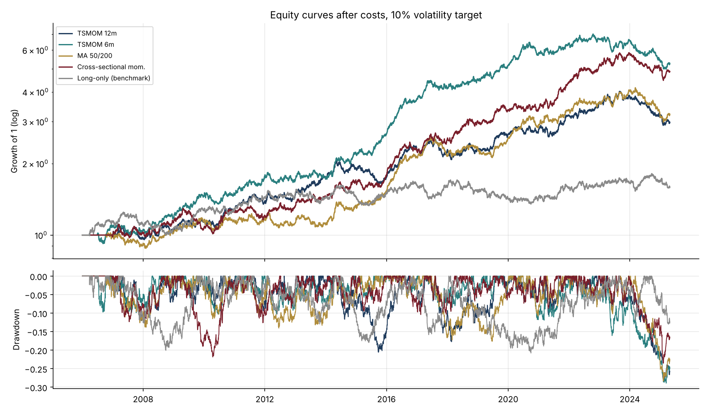
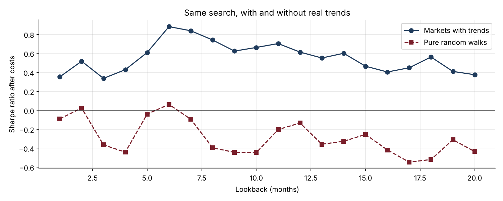

# 19 · Backtesting Systematic Strategies Without Fooling Yourself

[](https://colab.research.google.com/github/adamrejeb86-del/-finance-portfolio/blob/main/19-systematic-strategy-backtester/systematic_strategy_backtester.ipynb) [](https://nbviewer.org/github/adamrejeb86-del/-finance-portfolio/blob/main/19-systematic-strategy-backtester/systematic_strategy_backtester.ipynb)

Most backtests I have seen shared online look great and would never survive real trading: they peek at tomorrow's prices, ignore costs, or keep the best of fifty parameter sets. I wanted to build a small engine that refuses to do any of that, and use it on the classic CTA strategies.



## What I built
- `backtest.py`, a vectorised engine. Signals at today's close are traded tomorrow, every market is sized to the same volatility, the book is scaled to a 10% vol target, and costs are charged on turnover.
- Four strategies on 12 futures markets over 20 years: time-series momentum (12m and 6m), a 50/200 moving-average crossover, and cross-sectional momentum, against a long-only equal-risk benchmark.
- An overfitting check: the same 20-lookback search on pure random walks, plus the Deflated Sharpe Ratio (Bailey and López de Prado).
- `test_backtest.py`, five tests. The one I care most about changes future returns and checks that no past position moves.

The market data are simulated with hidden trends, so I know there is something real to find, and with a no-trend version to see what luck alone produces.

## Results (after 2 bp costs, 10% vol target)
| Strategy | Sharpe | CAGR | Max drawdown | Hit rate | Turnover |
|---|---|---|---|---|---|
| Time-series momentum 6m | **0.88** | 8.9% | −29% | 52% | 36×/yr |
| Cross-sectional momentum | 0.87 | 8.7% | −24% | 53% | 35×/yr |
| MA crossover 50/200 | 0.64 | 6.3% | −28% | 52% | 18×/yr |
| Time-series momentum 12m | 0.61 | 5.9% | −28% | 51% | 30×/yr |
| Long-only benchmark | 0.28 | 2.4% | −21% | 51% | 5×/yr |



## What I learned
- **Trend following wins with a 52% hit rate.** The edge comes from letting a few big trends run, not from being right often.
- **Costs reorder the strategies.** At 10 bp, 12-month momentum loses almost half its Sharpe ratio, and the slowest strategy becomes one of the most robust.
- **Luck looks like skill.** On random walks, the best of 20 lookbacks still shows a positive Sharpe. The Deflated Sharpe Ratio gives it an 11% chance of being genuine, against 99% on the trending data.
- **It pays in bad months.** In the worst fifth of equity months, the 12-month trend strategy averaged +0.3% while long-only lost 1.9%.

## Limits and next steps
Simulated prices have no roll yield, gaps or regime changes like real futures. Next I would plug in real continuous futures data, select parameters walk-forward, and add a carry signal.

## Run it
```bash
pip install -r ../requirements.txt
pytest -q
jupyter notebook systematic_strategy_backtester.ipynb
```
