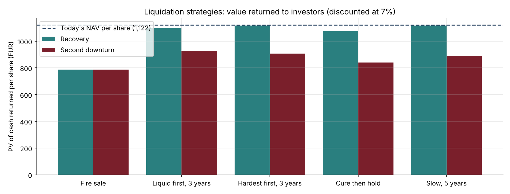
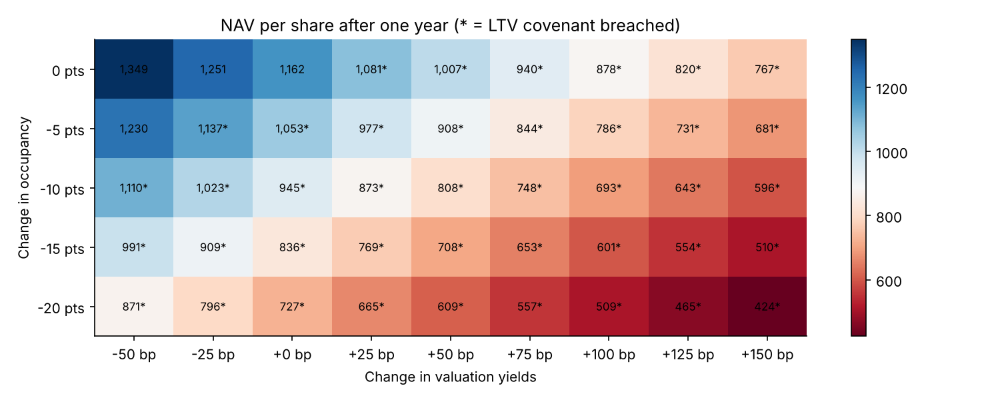

# 20 · Real Estate Fund Model: NAV, Covenants and Liquidation Strategy

[](https://colab.research.google.com/github/adamrejeb86-del/-finance-portfolio/blob/main/20-real-estate-fund-model/real_estate_fund_model.ipynb) [](https://nbviewer.org/github/adamrejeb86-del/-finance-portfolio/blob/main/20-real-estate-fund-model/real_estate_fund_model.ipynb)

This one is closest to my day job. At Amundi I worked in real estate fund management, following bank covenants (LTV, ICR) and refinancing, and building the analysis behind the liquidation of a fund in difficulty. I rebuilt that kind of analysis from scratch in Python, on a **fictitious** fund: no data from any employer is used.

The situation: after a market correction, a 14-building fund (offices, retail, logistics, residential, hotels) is just above its 40% LTV limit, and investors want their money back. Where is the fund heading, how much stress can it take, and how should it be sold?



## What I built
- `refund.py` covers income-based valuation (NOI / yield), a 10-year cash-flow and NAV projection, covenant tests, shock scenarios and a liquidation engine. The engine sells buildings in a chosen order and timing, applies fire-sale discounts by sector, repays the bank first and distributes the rest.
- The notebook covers the portfolio risk map, three scenarios, a sensitivity grid flagging covenant breaches, and five wind-down strategies tested in a recovery and in a second downturn.
- `test_refund.py` has six tests. One is a conservation check: selling everything today at appraisal, with no costs, returns exactly the NAV.

## Results
| Question | Answer |
|---|---|
| Starting point | NAV €1,122 per share, LTV 40.5% (limit 40%), ICR 3.3x |
| Base case | LTV back below 40% within a year, NAV growing with rent indexation |
| Yields +75 bp | NAV −19% in one year, LTV covenant breached for 7 years |
| Binding covenant | LTV, every time. ICR never falls below 3x |
| Fire sale | €788 per share returned, the worst strategy in both markets |
| Most robust wind-down | Liquid assets first over 3 years: €1,095 (recovery) / €928 (second downturn) |



## What I learned
- **Valuations break funds, not rents.** A small move in yields shifts the LTV far more than a vacancy shock shifts the ICR.
- **The best plan is the one with the best worst case.** Selling the hardest assets first wins if the market recovers, but loses if it falls again. Selling liquid assets first protects investors in both.
- **Sale proceeds go to the bank first.** That is why any orderly sale cures the LTV breach within a year.

## Limits and next steps
Rents are modelled per building, not lease by lease, so there are no break options or indexation caps. The next steps are refinancing risk at debt maturity, redemption queues, and a Monte Carlo of yields instead of two market paths.

## Run it
```bash
pip install -r ../requirements.txt
pytest -q
jupyter notebook real_estate_fund_model.ipynb
```
