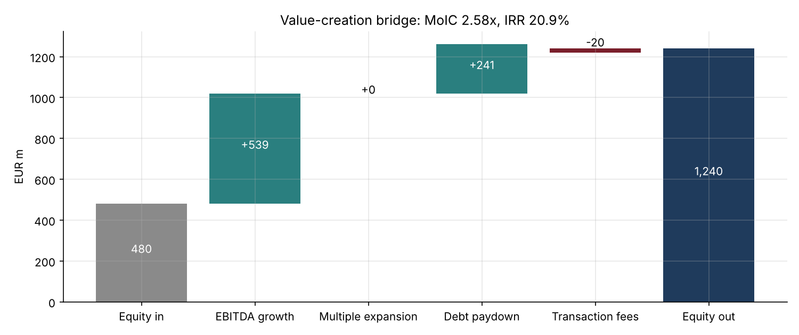
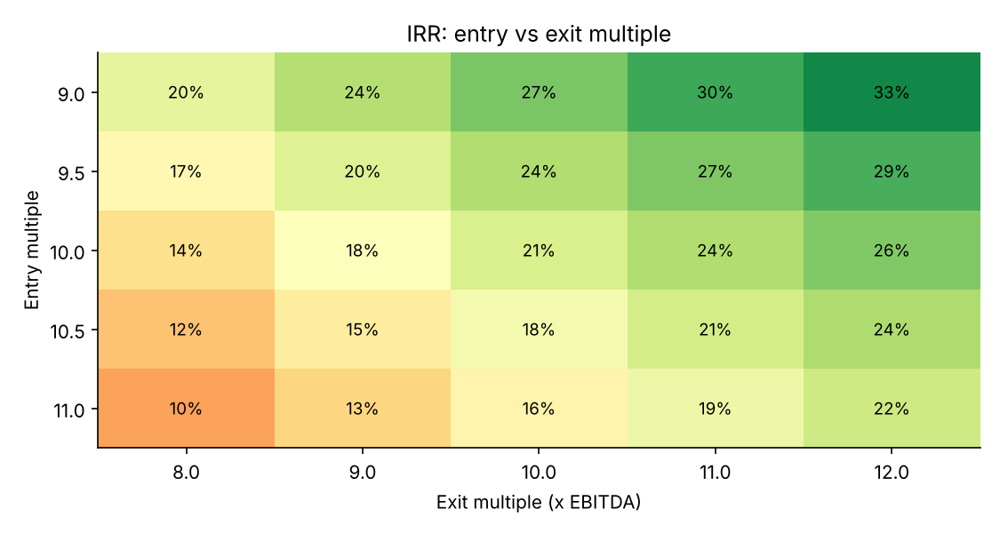

# 21 · LBO Model in Python

[](https://colab.research.google.com/github/adamrejeb86-del/-finance-portfolio/blob/main/21-lbo-model/lbo_model.ipynb) [](https://nbviewer.org/github/adamrejeb86-del/-finance-portfolio/blob/main/21-lbo-model/lbo_model.ipynb)

Private equity firms like Ardian, KKR or Blackstone build an LBO model for every deal they look at. I wanted to rebuild one from scratch to really understand the mechanics, then use code to do what is tedious in Excel: test hundreds of scenarios and check that the model always balances.

The deal: buy a company with €100m of EBITDA at 10x, financed with a term loan B (4.0x), senior notes (1.5x) and sponsor equity, then sell after five years.



## What I built
- `lbo.py`, the model itself:
  - sources and uses;
  - an operating model with margin expansion;
  - a debt schedule with 1% amortisation and a 75% cash sweep;
  - credit ratios, IRR and money multiple;
  - a value-creation bridge, sensitivity tables;
  - a formatted Excel export (`lbo_model.xlsx`).
- `lbo_model.ipynb` walks through the deal step by step, with the deleveraging chart, the bridge, the investment-committee sensitivity tables and a downside case.
- `test_lbo.py`, seven checks:
  - sources equal uses;
  - debt never negative and the cash floor respected;
  - the value bridge adds up exactly;
  - IRR consistent with the money multiple;
  - each driver moves returns in the right direction;
  - the Excel export works.

## Results
| | Base case | Downside |
|---|---|---|
| Sponsor equity | €480m (47% of the financing) | same |
| Money multiple / IRR | **2.58x / 20.9%** | 0.65x / −8.3% |
| Net leverage at exit | 1.9x | 4.5x |

Where the base-case gain comes from: 71% from EBITDA growth, 32% from debt paydown, −3% from fees, and nothing from the exit multiple.



## What I learned
- **A good deal does not need multiple expansion.** I kept the exit multiple equal to the entry multiple on purpose; if a deal only works with a higher exit multiple, it is a bet on the market, not on the company.
- **One turn of exit multiple is worth about 3 points of IRR**, as much as two points of extra annual sales growth.
- **Leverage cuts both ways.** It adds 2 to 3 points of IRR per turn in the base case, and turns a flat-sales scenario into a loss of a third of the equity.
- **Opening-balance interest** avoids the circular reference you get in Excel with average balances. It is a small modelling choice, but it has to be stated.

## Limits and next steps
The model is annual and has a single debt sweep. I would add management equity, a PIK tranche, quarterly covenant tests, a dividend recap and an add-on acquisition.

## Run it
```bash
pip install -r ../requirements.txt
pytest -q
jupyter notebook lbo_model.ipynb
```
