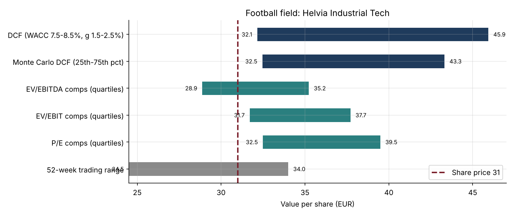
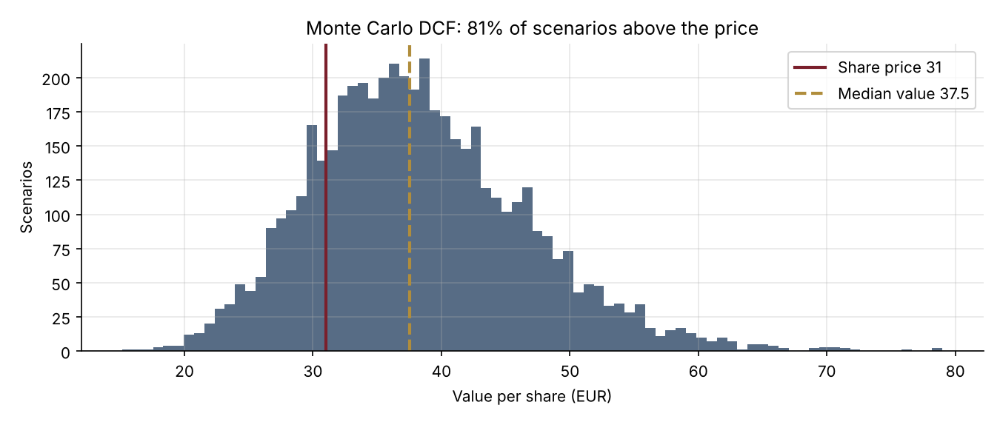

# 22 · Valuing a Company: DCF, Comparables and a Football Field

[](https://colab.research.google.com/github/adamrejeb86-del/-finance-portfolio/blob/main/22-dcf-valuation/dcf_valuation.ipynb) [](https://nbviewer.org/github/adamrejeb86-del/-finance-portfolio/blob/main/22-dcf-valuation/dcf_valuation.ipynb)

Valuation came up in almost every course of my Master's, but always one method at a time. Here I put the full toolkit an equity analyst or an M&A team uses on one fictional company, Helvia Industrial Tech (share price €31), and tried to answer the real question: *what is it worth, and how confident can we be?*



## What I built
- `dcf.py` contains the full toolkit:
  - a WACC from CAPM, with the beta re-levered (Hamada);
  - a 10-year FCFF forecast with growth fading to the terminal rate;
  - a mid-year DCF with a Gordon terminal value and the equity bridge (net debt, pensions, minorities);
  - a sensitivity grid, a Monte Carlo on growth, margins and WACC;
  - a reverse DCF and trading comparables.
- `dcf_valuation.ipynb` follows the same order as an analyst's note: WACC, forecast, value bridge, sensitivities, then the football field.
- `test_dcf.py` has seven checks:
  - WACC arithmetic;
  - the Gordon formula and its guard (the WACC must exceed g);
  - EV equal to the sum of its parts;
  - the equity bridge;
  - the FCFF definition;
  - monotonic sensitivities;
  - a reverse DCF that reprices the share exactly.

## Results
| Output | Value |
|---|---|
| WACC | 8.1% (re-levered beta 1.20, cost of equity 9.6%) |
| DCF value per share | **€37.3** vs €31 market price |
| Terminal value share of EV | 59%, implied exit multiple 9.0x (peer median 9.9x) |
| Monte Carlo | 80% of scenarios above the price, median €37.5 |
| Reverse DCF | the price implies about 4% annual growth, against 7% in the plan |
| Peer multiples (quartiles) | €29 to €40 per share |



## What I learned
- **The terminal value is most of the answer.** Checking the multiple it implies against peers is the quickest way to catch an aggressive DCF.
- **The reverse DCF changes the conversation.** Instead of defending €37, the question becomes whether the company can grow by more than 4% a year, which is easier to debate with a client or a committee.
- **One number is never enough.** The football field shows where the methods agree (about €32 to €38) and where they don't.

## Limits and next steps
Next I would add a full three-statement model, an APV valuation for a changing capital structure, precedent transactions with control premia, and a sum-of-the-parts.

## Run it
```bash
pip install -r ../requirements.txt
pytest -q
jupyter notebook dcf_valuation.ipynb
```
