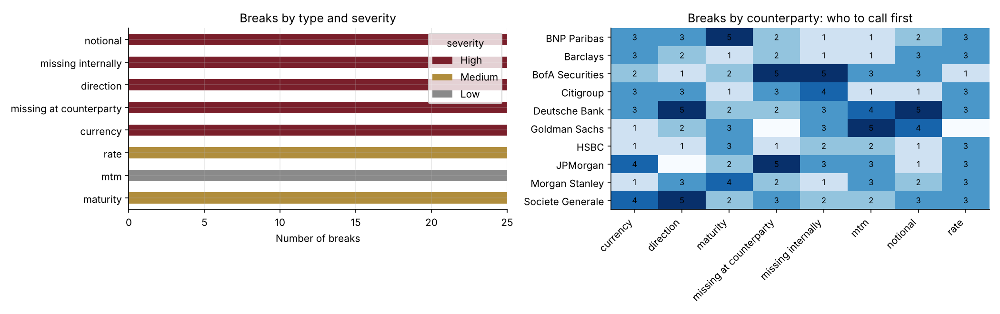

# 23 · Automated OTC Trade Reconciliation (EMIR-style)

[](https://colab.research.google.com/github/adamrejeb86-del/-finance-portfolio/blob/main/23-trade-reconciliation/trade_reconciliation.ipynb) [](https://nbviewer.org/github/adamrejeb86-del/-finance-portfolio/blob/main/23-trade-reconciliation/trade_reconciliation.ipynb)

During my internship on Amundi's structured products team, I confirmed OTC trades with JPMorgan, Goldman Sachs, BofA and Morgan Stanley every day, and automated the EMIR regulatory controls in VBA: a check that took about four hours went down to under a minute. This project rebuilds that kind of control in Python, from scratch and on **synthetic** trades, and pushes it further: economic matching when the UTI is missing, tolerances per field, severity, and a report ready to send.



## What I built
- `recon.py` runs the whole control:
  - a trade generator for IRS, cross-currency swaps, FX forwards, options and CDS across ten bank counterparties;
  - a counterparty file with realistic breaks injected;
  - the reconciliation engine: UTI match, economic match, then tolerant field comparison;
  - severity classification and a formatted Excel report.
- `trade_reconciliation.ipynb` follows the daily process, from break analysis to the report and a scale test.
- `test_recon.py` has six tests:
  - identical books give zero breaks;
  - every injected break is found with the right type;
  - there are no false alarms;
  - trades without a UTI are matched on economics;
  - valuation noise is tolerated;
  - the Excel report is complete.

## Results
| Check | Result |
|---|---|
| Breaks injected / detected / false alarms | 200 / **200** / **0** |
| Trades without UTI re-paired on economics | 25 of 25 |
| 200,000 trades reconciled | about 0.6 seconds |
| Output | `reconciliation_report.xlsx`: summary, counterparty × break-type table, filterable list with colour-coded severity |

## What I learned
- **Matching is the hard part, not comparing.** A trade without a UTI shows up as two false "one-sided" breaks unless the engine pairs it on its economics, and that pairing has to be one-to-one.
- **Tolerances decide whether the report is used.** Without them, valuation noise floods the list, and the real breaks get lost.
- **Severity should follow the regulation.** A wrong notional or direction misstates exposure, which is what EMIR is about. A small MTM gap is a collateral discussion.

## Limits and next steps
Next steps: read real EMIR Refit / ISO 20022 files, track break ageing and ownership, and email each counterparty its own list automatically.

## Run it
```bash
pip install -r ../requirements.txt
pytest -q
jupyter notebook trade_reconciliation.ipynb
```
