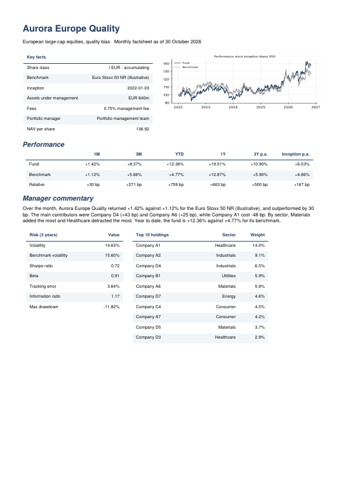
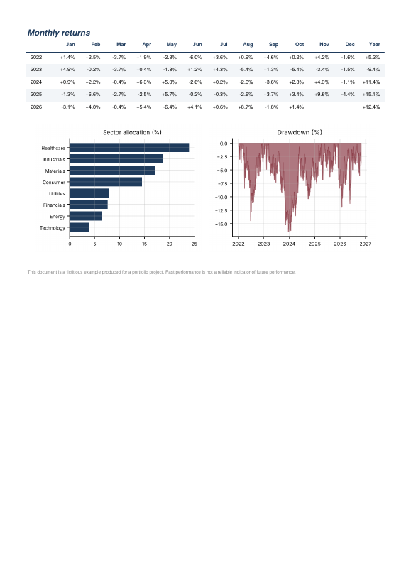

# 24 · Automated Fund Reporting: Factsheets in Seconds

[](https://colab.research.google.com/github/adamrejeb86-del/-finance-portfolio/blob/main/24-fund-reporting-automation/fund_reporting.ipynb) [](https://nbviewer.org/github/adamrejeb86-del/-finance-portfolio/blob/main/24-fund-reporting-automation/fund_reporting.ipynb)

Reporting took a large share of my time in asset management: quarterly reviews for senior management at Amundi, and strategy and performance materials for clients when I was selling funds at Montpensier Finance. Most of it was moving numbers from one system to another. Here I automated the whole chain for a range of three fictitious funds, from raw NAV and holdings data to a two-page PDF factsheet and an Excel data pack.

<p align="center"> </p>

## What I built
- `factsheet.py` produces everything:
  - period returns (1M, 3M, YTD, 1Y, 3Y p.a., since inception);
  - a calendar-month table;
  - 3-year risk statistics against the benchmark (volatility, Sharpe, beta, tracking error, information ratio, max drawdown);
  - charts;
  - a rule-based commentary;
  - the PDF (reportlab) and an Excel pack.
- `fund_reporting.ipynb` walks through the analytics, the commentary, the batch run for the fund range and the finished factsheet.
- `test_factsheet.py`, five tests:
  - annualisation on a known series;
  - monthly returns compounding exactly to the annual figure;
  - sensible risk statistics;
  - a commentary that quotes the computed numbers;
  - a complete PDF and Excel output.

## Results
- **Three funds, three factsheets and three data packs in about 1.5 seconds.** No copy-paste anywhere.
- **The commentary is written from the data.** It covers relative performance, top and bottom contributors, sectors and year-to-date. Every sentence can be traced to a number, which matters for compliance.
- **The holdings add up exactly to the fund's monthly return**, so the attribution in the comment is consistent with the performance table.

## What I learned
- **Rules beat free text for client documents.** An LLM could write a nicer comment, but it could also invent a reason for a move. Rules that quote computed figures are auditable. An LLM could still polish that text later, under review.
- **The formatting details take the most time**: column widths, alignment, page breaks. Once they are coded, they never have to be redone by hand.

## Limits and next steps
Next steps: plug into a real NAV and holdings database, add currency-hedged share classes, ESG indicators and multi-language output, then schedule the run at month-end with an automatic email to the sales team.

## Run it
```bash
pip install -r ../requirements.txt
pytest -q
jupyter notebook fund_reporting.ipynb
```
The generated PDFs and Excel files are in `output/`.
