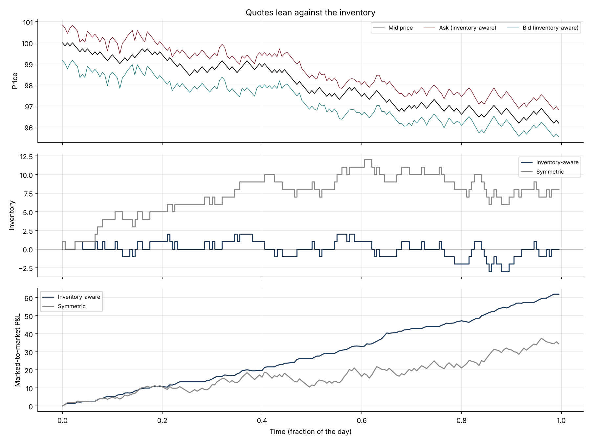
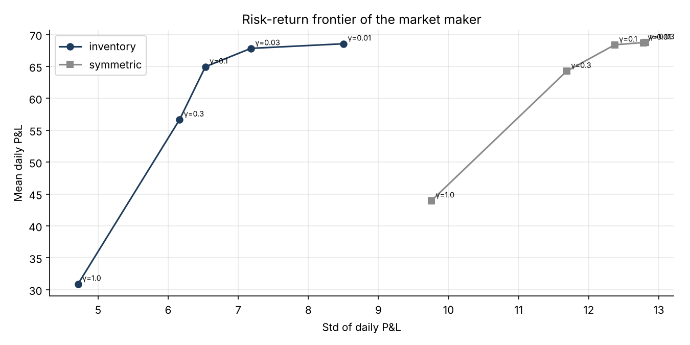

# 26 · Market Making with Inventory Risk (Avellaneda-Stoikov)

[](https://colab.research.google.com/github/adamrejeb86-del/-finance-portfolio/blob/main/26-market-making/market_making.ipynb) [](https://nbviewer.org/github/adamrejeb86-del/-finance-portfolio/blob/main/26-market-making/market_making.ipynb)

When I confirmed trades with bank counterparties, I was on the other side of their market-making books. I wanted to understand the trader's side: how wide to quote, and how to move prices when a position builds up. This project implements the classic answer, the Avellaneda-Stoikov model, and reproduces the results of the paper by simulation.



## What I built
- `mm.py` simulates a dealer on thousands of trading days. The mid follows a random walk, clients arrive as Poisson flows that thin out as the quote moves away from the mid, and the dealer can quote two ways:
  - an **inventory-aware** strategy, with quotes around the reservation price $r = s - q\gamma\sigma^2(T-t)$;
  - a **symmetric** strategy, with the same spread around the mid.
- `market_making.ipynb` follows one day tick by tick, then shows the P&L and inventory distributions, the risk-aversion frontier and the effect of volatility.
- `test_mm.py`, five tests:
  - the reservation price skews against inventory;
  - the spread tends to 2/k without risk aversion;
  - the simulated fill rate matches the intensity;
  - the inventory-aware strategy controls risk;
  - inventory limits are respected.

## Results (2,000 simulated days, γ = 0.1, the paper's parameters)
| Strategy | Mean P&L | Std P&L | Std of final inventory |
|---|---|---|---|
| Inventory-aware (Avellaneda-Stoikov) | 65.0 | **6.5** | **2.9** |
| Symmetric, same spread | 68.1 | 13.3 | 8.4 |

These figures are close to those reported in the original paper for the same parameters.



## What I learned
- **A dealer's real risk is the inventory, not the spread.** Quoting symmetrically earns slightly more, but at the price of an unwanted directional position.
- **Skewing the quotes is a hedge.** Moving both quotes against the position gives up a little spread and halves the P&L volatility.
- **Volatility widens spreads mechanically.** From σ = 1 to σ = 4, the optimal spread doubles and trading volume drops by a quarter, just like on real screens in a stressed market.
- **A small bug taught me to test counters.** Adding two boolean arrays in NumPy is a logical OR, not a sum, and my trade count was 13% too low until a test compared it with the theoretical intensity.

## Limits and next steps
Next: model informed clients (adverse selection), add a running inventory penalty (Guéant-Lehalle-Fernandez-Tapia), let a multi-asset dealer hedge with a correlated instrument, and calibrate A and k to order-book data.

## Run it
```bash
pip install -r ../requirements.txt
pytest -q
jupyter notebook market_making.ipynb
```
