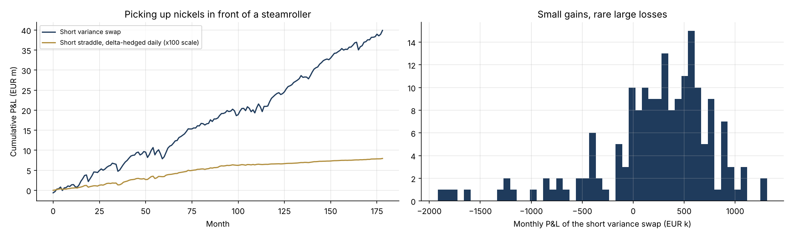

# 27 · Volatility Trading: Variance Swaps and the Volatility Risk Premium

[](https://colab.research.google.com/github/adamrejeb86-del/-finance-portfolio/blob/main/27-volatility-trading/volatility_trading.ipynb) [](https://nbviewer.org/github/adamrejeb86-del/-finance-portfolio/blob/main/27-volatility-trading/volatility_trading.ipynb)

Structured products like the autocalls I confirmed at Amundi leave banks short volatility, and someone has to take the other side. Volatility is an asset class of its own on equity derivatives desks. I wanted to understand its main instrument, the variance swap, and the trade behind so many strategies: selling volatility to collect the risk premium.



## What I built
- `voltrading.py` covers four things:
  - the variance swap strike by static replication with a strip of out-of-the-money options (Demeterfi-Derman-Kamal-Zou);
  - realised variance and P&L in vega notional;
  - a stochastic-volatility market with crash spikes and an implied-volatility premium;
  - a monthly short-variance strategy and a delta-hedged short straddle.
- `volatility_trading.ipynb` goes through replication across three smiles, the convexity of variance, the risk premium in the data, and the two short-vol strategies.
- `test_voltrading.py` has six tests:
  - replication recovers a flat volatility exactly;
  - skew makes variance more expensive;
  - realised-variance convention;
  - P&L in vega notional;
  - the short variance strategy has a positive mean and negative skew;
  - the straddle premium effect.

## Results
| Finding | Value |
|---|---|
| 3-month variance strike, flat 20% smile | 20.00% |
| Same with a steep equity skew | **23.5%**: the buyer pays for the crash protection in low strikes |
| Days where implied vol > subsequently realised | 76% |
| Short 1-month variance, €100k vega, 15 years | wins 75% of months, Sharpe 1.35, skewness −1.35 |
| Worst month vs average month | −€1.9m vs +€0.22m |

## What I learned
- **A variance swap prices the whole smile.** With an equity skew, its strike sits well above ATM volatility.
- **Variance is convex in volatility.** On €100k vega notional, realised vol at 60 instead of 20 costs €8m, while a fall to 10 earns only €0.75m. Selling variance means selling that convexity.
- **The volatility premium is an insurance premium.** A Sharpe ratio above 1 hides a strongly negative skew, so the position should be sized on its stress loss, not on its Sharpe ratio.

## Limits and next steps
Next: VIX futures and the volatility term structure, corridor and gamma swaps, and dispersion trading (project 33).

## Run it
```bash
pip install -r ../requirements.txt
pytest -q
jupyter notebook volatility_trading.ipynb
```
