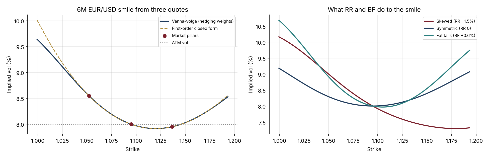

# 28 · FX Options: Market Conventions and the Vanna-Volga Smile

[](https://colab.research.google.com/github/adamrejeb86-del/-finance-portfolio/blob/main/28-fx-options-vanna-volga/fx_options.ipynb) [](https://nbviewer.org/github/adamrejeb86-del/-finance-portfolio/blob/main/28-fx-options-vanna-volga/fx_options.ipynb)

FX is the most liquid options market, and the one where a quant sales or junior trader gets lost fastest. Nobody quotes strikes: prices come as "6-month 25-delta risk reversal at −0.60", and "delta" itself has three definitions. I wanted to be able to go from a broker's quote to a client price, so I built that chain end to end.



## What I built
- `fxopt.py` covers:
  - Garman-Kohlhagen pricing and forwards from covered interest parity;
  - spot, forward and premium-adjusted deltas;
  - strike-from-delta solvers, including the non-monotonic premium-adjusted case;
  - the ATM delta-neutral straddle strike;
  - smile pillars from ATM / RR / BF quotes;
  - vanna-volga pricing, by hedging weights and by the closed-form approximation.
- `fx_options.ipynb` goes from forward points, through delta conventions and quotes to pillars, to the vanna-volga smile and a client trade.
- `test_fxopt.py` has eight tests:
  - put-call parity;
  - delta-to-strike round trips for all four conventions;
  - the DNS straddle is delta-neutral;
  - vanna-volga reproduces the three market pillars exactly;
  - flat quotes give a flat smile.

## Results (6-month EUR/USD, ATM 8.00%, RR −0.60%, BF +0.25%)
| Output | Value |
|---|---|
| 25Δ put / ATM / 25Δ call strikes | 1.0520 / 1.0949 / 1.1366 |
| Pillar vols | 8.55% / 8.00% / 7.95% |
| 25Δ call strike, spot vs premium-adjusted delta | 1.1369 vs 1.1351 |
| Client EUR put 1.0500 on EUR 10m | 8.59% vol, premium USD 96.9k, of which **USD 13.8k comes from the skew** |

## What I learned
- **Conventions are part of the price.** The same "25 delta" gives different strikes depending on the delta definition, and premium-adjusted call deltas are not even monotonic in the strike, so the solver has to search on the right branch.
- **Vanna-volga is a hedging argument, not a curve fit.** The smile is what it costs to hedge vega, vanna and volga with the three liquid options.
- **On a protective put, the skew is a real cost** for the client: here 17% of the premium.

## Limits and next steps
Next: a full surface across tenors, SABR as an alternative smile model, barrier and one-touch options priced with vanna-volga, and the broker-fly vs smile-fly distinction.

## Run it
```bash
pip install -r ../requirements.txt
pytest -q
jupyter notebook fx_options.ipynb
```
