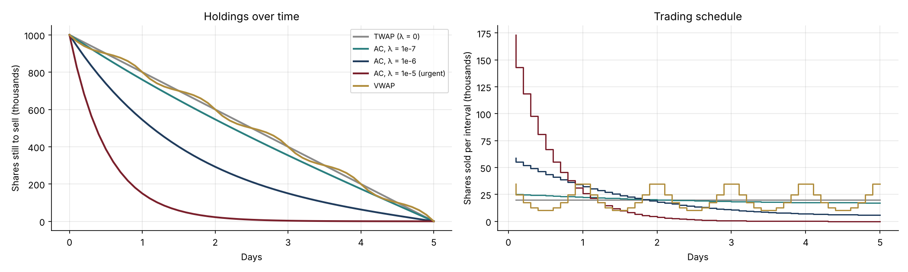
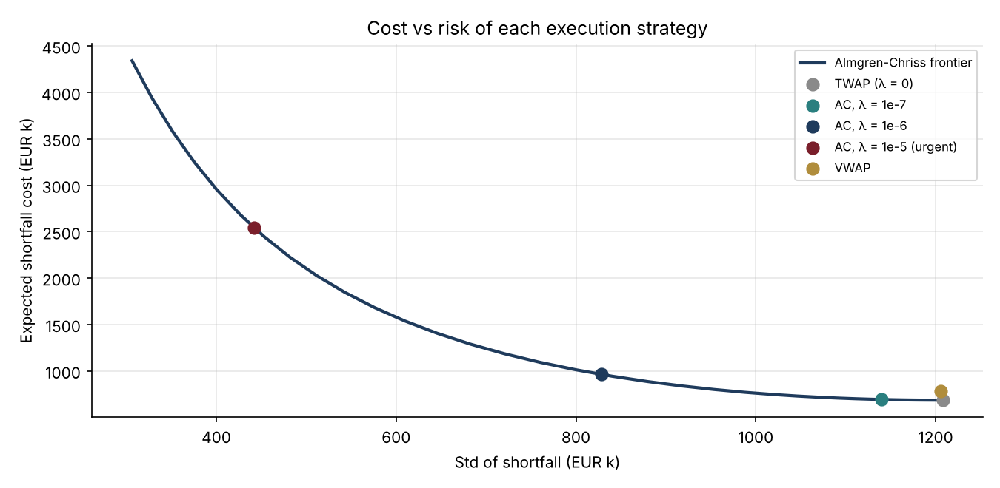

# 29 · Optimal Execution: Selling a Large Block (Almgren-Chriss)

[](https://colab.research.google.com/github/adamrejeb86-del/-finance-portfolio/blob/main/29-optimal-execution/optimal_execution.ipynb) [](https://nbviewer.org/github/adamrejeb86-del/-finance-portfolio/blob/main/29-optimal-execution/optimal_execution.ipynb)

When a client asks a desk to sell a million shares, the trader has a dilemma: sell fast and push the price down, or sell slowly and risk the price moving anyway. I implemented the Almgren-Chriss model, which turns that dilemma into a cost-versus-risk frontier, and compared it with the two schedules execution desks use every day, TWAP and VWAP.



## What I built
- `execution.py` contains:
  - the closed-form Almgren-Chriss trajectory and its expected cost and variance;
  - TWAP and VWAP schedules, using a U-shaped intraday volume curve;
  - a Monte Carlo of the price with permanent and temporary impact;
  - the efficient frontier.
- `optimal_execution.ipynb` covers the trajectories, the frontier, and the distribution of execution costs over 20,000 simulations.
- `test_execution.py`, five tests:
  - λ = 0 gives back TWAP exactly;
  - every trajectory starts full and ends empty;
  - risk aversion front-loads the selling and trades cost for risk;
  - the closed form matches the simulation (mean and standard deviation);
  - VWAP sells the whole order.

## Results (1 million shares at €50 over 5 days, the paper's example)
| Strategy | Expected cost | Std of cost | 95th percentile |
|---|---|---|---|
| TWAP | €0.69m (137 bp) | €1.21m | €2.67m |
| Almgren-Chriss λ = 1e-6 | €0.96m | €0.83m | **€2.32m** |
| Almgren-Chriss λ = 1e-5 (urgent) | €2.55m | €0.44m | €3.28m |
| VWAP | €0.78m | €1.21m | €2.76m |



## What I learned
- **The best execution depends on the client's objective.** TWAP minimises the average cost; a moderate risk aversion minimises the bad outcomes. Selling too urgently is worse on both counts.
- **Execution has an efficient frontier, like portfolios.** VWAP sits slightly above it here, because this model's impact does not depend on market volume, which is the real reason traders follow the volume curve.
- **Timing conventions matter in a simulation.** My first Monte Carlo charged the permanent impact before the trade instead of after it, and its average cost no longer matched the closed form. The test against the formula caught it.

## Limits and next steps
Next: square-root impact calibrated to real data, volume-dependent impact (where VWAP becomes optimal), limit orders and dark pools, and adaptive strategies that react to price moves.

## Run it
```bash
pip install -r ../requirements.txt
pytest -q
jupyter notebook optimal_execution.ipynb
```
