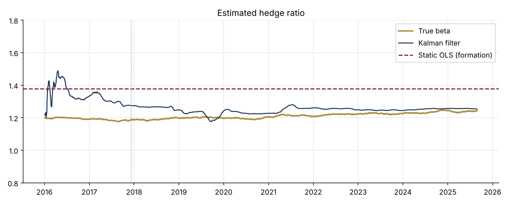
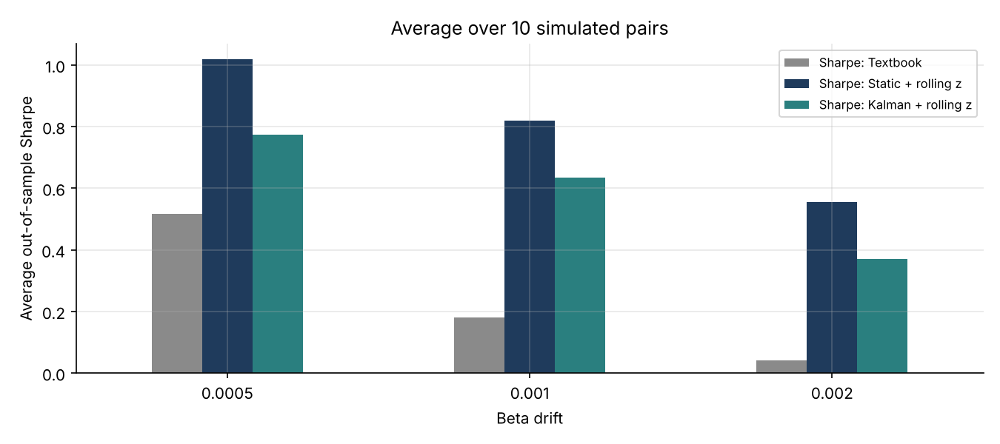

# 30 · Pairs Trading: Cointegration and a Kalman Hedge Ratio

[](https://colab.research.google.com/github/adamrejeb86-del/-finance-portfolio/blob/main/30-pairs-trading-kalman/pairs_trading.ipynb) [](https://nbviewer.org/github/adamrejeb86-del/-finance-portfolio/blob/main/30-pairs-trading-kalman/pairs_trading.ipynb)

Pairs trading is usually the first statistical arbitrage strategy people learn, and the Kalman filter is often presented as the upgrade that makes it work. I wanted to test that claim properly rather than repeat it. I simulated the pairs so that the true hedge ratio is known, traded them out of sample with costs and a one-day lag, and compared three versions of the strategy on 30 pairs.



## What I built
- `pairs.py` contains:
  - the Engle-Granger cointegration test, with my own ADF statistic;
  - the half-life of mean reversion;
  - a Kalman filter for a time-varying hedge ratio;
  - z-score signals with entry and exit bands;
  - a backtest with execution lag and transaction costs.
- `pairs_trading.ipynb` follows a stat-arb workflow:
  - a two-year formation period, then eight years of trading;
  - a robustness grid of 10 pairs at each of 3 levels of beta drift;
  - a decomposition of the Kalman filter's effect into hedge and signal;
  - a control on pairs that are not cointegrated.
- `test_pairs.py`, six tests:
  - the ADF test separates a stationary series from a random walk;
  - Engle-Granger detects cointegration only when it is present;
  - the half-life is recovered;
  - the filter tracks a drifting beta;
  - the bands behave correctly;
  - there is no look-ahead, and costs reduce returns.

## Results (average out-of-sample Sharpe over 10 pairs, 5 bp costs)
| Beta drift | Textbook (static hedge, frozen z) | Static hedge + rolling z | Kalman + rolling z |
|---|---|---|---|
| Low | 0.52 | **1.02** | 0.77 |
| Medium | 0.18 | **0.82** | 0.63 |
| High | 0.04 | **0.56** | 0.37 |

Using the true beta and the true spread, an upper bound no trader can reach, gives 1.20 at medium drift.



## What I learned
- **The Kalman filter did not win, and the reason is precise.**
  - Its hedge ratio is better: used with the simple signal, it slightly improves the Sharpe (0.85 vs 0.82).
  - Its signal is worse. Each update absorbs about 1.4% of that day's spread error, so roughly 20% of a deviation lasting one half-life is explained away as a change in beta before it is traded.
- **The biggest mistake is a frozen z-score.** With a hedge ratio that is slightly wrong, part of every move in the second stock leaks into the spread. The textbook version then sat in a losing position 88% of the time.
- **The cointegration test is a strict filter.** None of the 10 unrelated pairs passed it, but it also rejected most of the pairs that were truly cointegrated, because two years of data are not much. On a desk the economic link between the two stocks matters as much as the p-value.
- **A free intercept kills the strategy.** In my first version, the filter's intercept was allowed to move as freely as the hedge ratio. It absorbed the spread entirely and the strategy never traded.

## Limits and next steps
- The data are simulated. Next is real sector pairs, with survivorship-free data.
- Other next steps:
  - a hedge ratio estimated on returns rather than on price levels;
  - filter noise tuned by maximum likelihood;
  - a stop-loss triggered when the half-life blows out.

## Run it
```bash
pip install -r ../requirements.txt
pytest -q
jupyter notebook pairs_trading.ipynb
```
