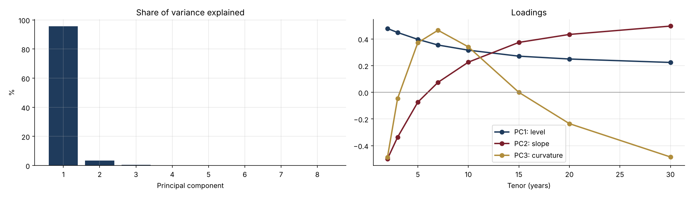
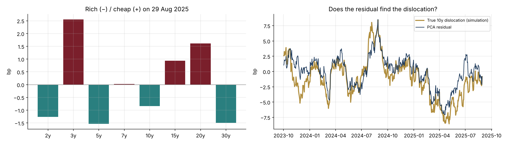

# 31 · Rates Relative Value with PCA: Steepeners, Butterflies and Rich/Cheap

[](https://colab.research.google.com/github/adamrejeb86-del/-finance-portfolio/blob/main/31-rates-relative-value-pca/rates_relative_value.ipynb) [](https://nbviewer.org/github/adamrejeb86-del/-finance-portfolio/blob/main/31-rates-relative-value-pca/rates_relative_value.ipynb)

Rates traders rarely trade a single maturity; they trade packages such as a 2s10s steepener or a 2s10s30s butterfly. The question I wanted to answer is how to size the legs so that a package carries only the risk it is meant to carry. Equal DV01 is the textbook answer, but it only neutralises a parallel shift. I compared it with PCA weights, built a rich/cheap screen from the PCA residuals, and backtested a butterfly strategy out of sample.



## What I built
- `rvpca.py` contains:
  - a curve history from three Nelson-Siegel factors plus tenor-specific dislocations;
  - a PCA of daily moves, with signed loadings for level, slope and curvature;
  - DV01 of par swaps;
  - factor exposures of any package;
  - DV01-neutral and PCA-neutral steepeners and butterflies;
  - rich/cheap residuals;
  - a butterfly mean-reversion backtest with bid-offer costs.
- `rates_relative_value.ipynb`: PCA on the first two years, then everything is tested on the following eight.
- `test_rvpca.py`, six tests:
  - the PCA rebuilds the covariance matrix exactly;
  - the DV01 of a swap is checked against a closed form;
  - a DV01-neutral steepener has zero P&L on a parallel shift;
  - PCA packages have zero exposure to level and slope;
  - the residuals recover the true dislocations;
  - the backtest has no look-ahead, and costs reduce the P&L.

## Results (out of sample)
| Package | Level risk | Slope risk | Daily P&L vol |
|---|---|---|---|
| 2s10s steepener, equal DV01 | **−€37.7k per 1-sd move** | +€32.2k | €54.7k |
| 2s10s steepener, PCA (10y leg × 1.5) | 0 | +€37.3k | €42.3k |
| 2s10s30s fly, 50/50 DV01 | −€8.2k | +€10.1k | €19.9k |
| 2s10s30s fly, PCA wings | 0 | 0 | €14.6k |

Butterfly mean-reversion strategy over 8 curve histories:
- Both weightings have the same average Sharpe ratio, about 0.5.
- The PCA fly runs with 25 to 27% less volatility in every history.



## What I learned
- **A DV01-neutral steepener is a disguised bet on rates.** The first factor is not parallel: its loading on the 2y is twice its loading on the 30y. As a result, the "pure slope" trade lost more on a typical level move than it made on a typical slope move.
- **PCA weights clean a trade; they do not make it more profitable.** The Sharpe ratios were the same. What changed is that half of the 50/50 fly's P&L variance came from level and slope, a curve view nobody meant to take.
- **A rich/cheap screen is a starting point, not a measurement.** The residuals tracked the true dislocations well for some tenors (correlation 0.85) and poorly for others (0.45). Fitting four parameters on eight points absorbs part of what you are looking for.
- **DV01 is the language of the desk.** Writing every position in EUR per bp made each hedge ratio a one-line calculation and each P&L easy to check.

## Limits and next steps
- The curves are simulated.
- Next steps:
  - real swap and government bond curves;
  - PCA re-estimated on a rolling window;
  - carry and roll-down in the signal;
  - bond-specific effects for government bond relative value (repo specials, cheapest-to-deliver).

## Run it
```bash
pip install -r ../requirements.txt
pytest -q
jupyter notebook rates_relative_value.ipynb
```
