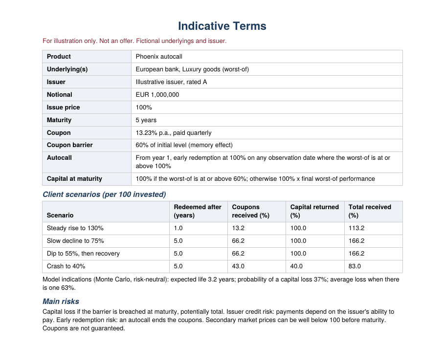
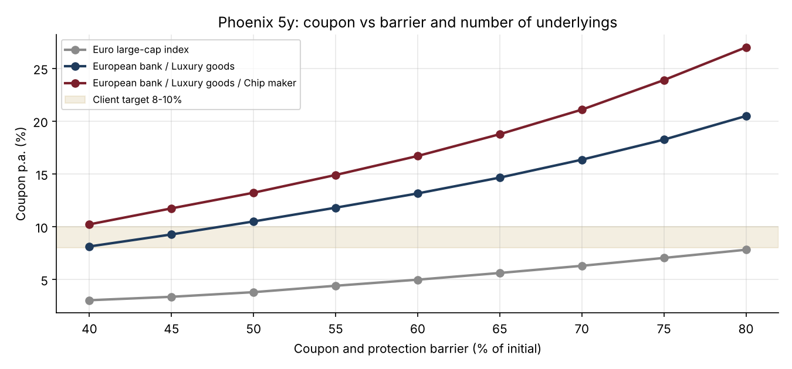

# 32 · Quant Sales Pricing Tool: from a Client Brief to a Term Sheet

[](https://colab.research.google.com/github/adamrejeb86-del/-finance-portfolio/blob/main/32-quant-sales-pricing-tool/quant_sales_pricer.ipynb) [](https://nbviewer.org/github/adamrejeb86-del/-finance-portfolio/blob/main/32-quant-sales-pricing-tool/quant_sales_pricer.ipynb)

At Amundi I confirmed structured trades after they were done, and at Montpensier I sold funds to independent advisers. This project joins the two: what a structured products salesperson does before the trade.

The notebook follows that work from start to finish:
- a private banker's brief;
- three proposals, priced the way an issuing bank prices them;
- the "what if" questions a client asks;
- a one-page indicative term sheet;
- a live pricer with sliders, in Colab.



## What I built
- `salestool.py` contains:
  - a correlated Monte Carlo of fictional underlyings;
  - three products: a worst-of Phoenix autocall with memory, a barrier reverse convertible, and a capital-protected note with participation;
  - issuer economics (funding spread and sales margin) and an exact coupon solve;
  - a barrier solver for a target coupon;
  - client scenarios;
  - a PDF term sheet generator.
- `quant_sales_pricer.ipynb` covers the proposals, a coupon sensitivity table, the redemption profile, the scenarios, the term sheet and an `ipywidgets` live pricer.
- `test_salestool.py`, seven tests:
  - every solved coupon reprices the note exactly to 100 minus the margin;
  - a zero-volatility case matches a closed form;
  - the coupon moves in the right direction with each risk;
  - the redemption profile sums to 1;
  - the scenario payoffs are correct;
  - the barrier solver hits its target;
  - the term sheet fits on one page.

## Results (5-year horizon, 1.5% sales margin, issuer spread 80 bp)
| Proposal | Coupon or participation | Probability of capital loss* | Average loss when there is one |
|---|---|---|---|
| Phoenix 5y, worst-of bank / luxury, 60% barriers | **13.2% p.a.** | 37% | 63% |
| Same Phoenix with the barrier solved for a 10% coupon (47.7%) | 10.0% p.a. | 28% | |
| Reverse convertible 2y, bank, 70% barrier | 9.7% p.a. | 32% | 45% |
| Capital-protected 6y, 3-stock basket | 119% participation | 0% | |

\* Risk-neutral probabilities: the measure used for pricing, not a forecast.

What moves the Phoenix coupon:
- the worst-of is the biggest lever: the index alone pays 4.9%;
- each extra stock or 5 points of volatility adds about 3 points;
- the issuer's credit spread funds almost 1 point;
- each point of sales margin costs the client about half a point a year.



## What I learned
- **The coupon is a price, not a promise.** Every extra point is paid for with something the client gives up: a lower barrier buffer, more volatility, one more stock, or exposure to the issuer's credit. The sensitivity table is the most useful slide for a client meeting.
- **Linearity makes the solver exact.** Each payoff is linear in its coupon, so on fixed paths the fair coupon is (target − A) / B, with no root-finding and no noise between quotes.
- **Risk-neutral is not real-world.** A 37% "probability of loss" is the pricing measure. Presenting it as a forecast would mislead a client, so the notebook and the term sheet say what it is.
- **Reinvestment risk is real.** About a quarter of the Phoenix notes are called after one year. A client attracted by a 13% coupon may receive it for only twelve months.

## Limits and next steps
- Flat volatility and continuous dividends are used here. Barrier products need a smile, so the next step is local or stochastic volatility.
- Other next steps:
  - a real issuer funding curve;
  - an Excel front end so salespeople can quote from a spreadsheet.

## Run it
```bash
pip install -r ../requirements.txt ipywidgets
pytest -q
jupyter notebook quant_sales_pricer.ipynb
```
