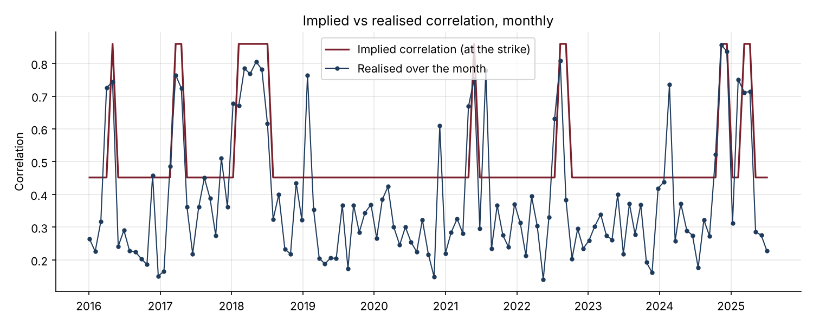
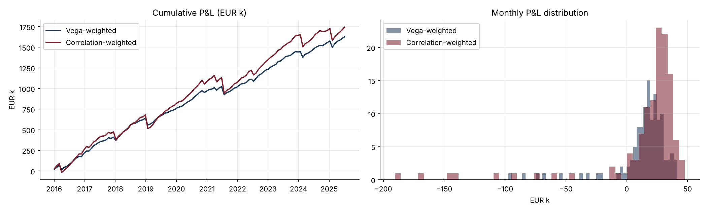

# 33 · Dispersion Trading: Implied Correlation and the Price of Index Protection

[](https://colab.research.google.com/github/adamrejeb86-del/-finance-portfolio/blob/main/33-dispersion-trading/dispersion_trading.ipynb) [](https://nbviewer.org/github/adamrejeb86-del/-finance-portfolio/blob/main/33-dispersion-trading/dispersion_trading.ipynb)

Index options are partly options on correlation. With the same ten stocks, moving from a calm correlation of 0.3 to a stressed 0.75 raises index vol from 17% to 25%. Because investors pay up for index protection, the correlation implied by option prices is usually above the one that is then realised. Volatility desks trade that gap with dispersion trades.

I built the strategy with monthly variance swaps on a simulated market with calm and stressed regimes, then looked at the two questions that matter: where the money comes from, and what the tail looks like.



## What I built
- `dispersion.py` contains:
  - the index-variance algebra and implied correlation;
  - a 10-stock market with regime-switching correlation and volatility;
  - fair variance strikes from the regime Markov chain, plus risk premiums;
  - variance swap P&L with vega notionals;
  - vega-weighted and correlation-weighted dispersion books;
  - strategy statistics.
- `dispersion_trading.ipynb` covers:
  - index vol against correlation;
  - realised correlation by regime;
  - implied against realised correlation;
  - the backtest of both sizings;
  - the anatomy of the worst months;
  - the sensitivity to the index premium;
  - robustness over 6 markets.
- `test_dispersion.py`, six tests:
  - implied correlation inverts the index formula;
  - the variance swap payoff and its convexity;
  - correlation weights neutralise a proportional vol move, while vega weights are net long vol;
  - regime-mixed expected variances;
  - realised correlation is recovered;
  - strikes use only past information.

## Results (10 years of monthly trades, EUR 10k index vega)
| | Vega-weighted | Correlation-weighted |
|---|---|---|
| Sharpe ratio | 2.06 | 1.24 |
| Months with a gain | 89% | 90% |
| Worst month | −€97k | −€191k |
| Skewness of monthly P&L | −2.8 | −3.4 |

- **Correlation:** implied averaged 0.51 against 0.38 realised.
- **Robustness:** over 6 simulated markets, the vega-weighted version had the higher Sharpe ratio and the correlation-weighted version the worse tail every time.
- **Index premium:** with the same 3% premium on the index as on the stocks, both versions lose money.



## What I learned
- **The sizing decides what the trade really is.**
  - With vega-weighted legs the trade is quietly long volatility, because the stocks are more volatile than the index. That cushions crises, since vols and correlation spike together.
  - Correlation weights remove that cushion and show the full tail of the correlation bet.
- **All the large losses come from calm markets that turn stressed.** Strikes set in a calm regime cannot price a jump to stress. Months that started in stress all made money, because their strikes already priced it.
- **The edge is the index protection premium, nothing else.** Without it, the trade is a negatively skewed bet with no reward. A desk would watch the size of the premium, not only its sign.
- **A high Sharpe ratio can hide a short-insurance profile.** A Sharpe ratio of 2 with a skewness of −3 is the signature of a strategy that sells protection. I would always report skew and worst month next to the Sharpe.

## Limits and next steps
- The 12% index premium is an assumption.
- On real data:
  - the premium varies over time;
  - a crash can be faster than a regime switch.
- Next steps:
  - real implied correlation data;
  - options instead of variance swaps (gamma and vega management);
  - an index put overlay to cut the tail;
  - trading only when the premium is wide.

## Run it
```bash
pip install -r ../requirements.txt
pytest -q
jupyter notebook dispersion_trading.ipynb
```
